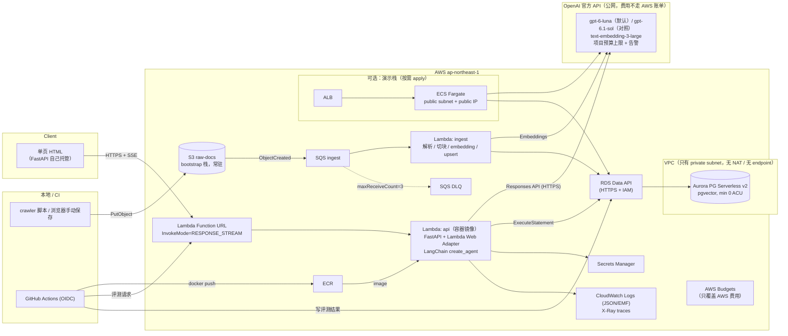
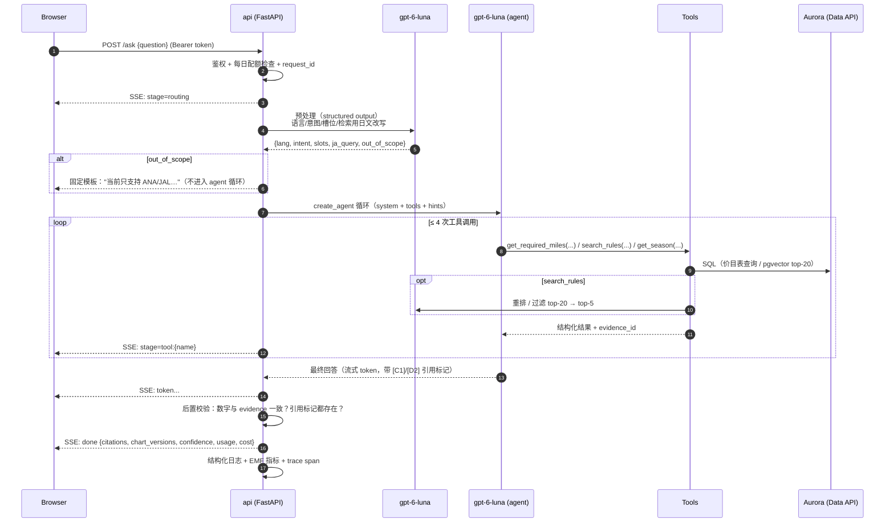

# Milewise 设计文档（v0.1 草案）

- 状态：Draft，等待 review
- 日期：2026-10-16
- 范围：第一版（ANA マイレージクラブ / JAL マイレージバンク，国际线特典航空券）

> 标记约定：**【已核实】** 表示 2026-10-16 实际访问官网确认过；**【待核实】** 表示基于已有知识、需要在 M1/M2 里用一条命令或一次控制台操作确认的事项。

### 变更记录

| 日期 | 变更 | 影响 |
|---|---|---|
| 2026-10-16 | **LLM 从 Amazon Bedrock（Claude）改为 OpenAI 官方 API**：所有 LLM 步骤都用 `gpt-6-luna`；对照 / 升级用 `gpt-6.1-sol`；embedding 用 `text-embedding-3-large`（`dimensions=1024`） | 价格与原先假设的 gpt-6-luna / gpt-6.1-sol 完全相同（$0.10/$0.50 和 $2/$10 每 1M token），所以成本估算不变。OpenAI 的费用**不走 AWS 账单**，AWS Budgets 和 AWS 抵扣额度都管不到它 → 新增 R20。Bedrock 相关的待核实项（原 R4）取消 |
| 2026-10-16 | **新开的 AWS 账户使用 Free plan（6 个月，$100–200 抵扣额度）** | 本项目需要的服务都在 Free plan 支持列表里（Aurora、RDS、Lambda、ECR、S3、SQS、Secrets Manager、Budgets、CloudWatch、X-Ray、VPC、ECS、ELB、IAM）。但 **IAM Identity Center、Organizations 不可用**，跨区域功能也不可用。另外，账户到期或额度用完后会被暂停 → 新增 R21 |
| 2026-10-16 | 默认全部用小模型；运行方式选常开 | 见 §6 |
| 2026-10-17 | **AWS 账户从 Free plan 升级为 Paid plan**。原因：spike 发现 Free plan 下 Aurora 只能用 express configuration（不能放进 VPC、只能 IAM 认证、存储 ≤ 1 GB），且 Terraform AWS provider 6.69.1 尚不支持该参数（[issue #47117](https://github.com/hashicorp/terraform-provider-aws/issues/47117)） | 原设计（VPC 私有 Aurora + Data API + 全部 Terraform）不用改；剩余抵扣额度 $140 保留；R21 降为低风险 |
| 2026-10-17 | **spike 实测完成**（R1 已验证）、**M1 完成**（本地端到端） | 结果见 §9 |
| 2026-10-18 | **去掉 Aurora：数据随镜像发布**（§4.6）。价目表直接读 repo 里的 CSV，规则索引（chunk + 向量）在构建时生成并打进镜像，内存检索；每日配额改用 DynamoDB，评测结果改存 S3 | 冷启动的约 20 秒唤醒等待消失；数据变更也要通过评测闸门，回滚 `live` 时数据一起回滚；Aurora、Data API、SQS/导入 Lambda 全部删除。§2、§4.3 中关于 Aurora 的内容保留为历史记录 |
| 2026-10-19 | **网页公开、不再需要 token**（§4.8）：按 IP 限流、回答缓存、全站每日预算（1000 次 / $2，先到先停，触发时发邮件）、开关、可选的 Turnstile；运营者 token 单独计额 | R7 的防护从"token"改为"硬预算 + 限流"：最坏情况每天 $2 |
| 2026-10-18 | **模型改为 Amazon Bedrock**（§4.7）：问答和重排用 Nova 2 Lite（`jp.` 日本跨区域推理），评测裁判用 Nova Pro，embedding 用 Titan Text Embeddings V2（1024 维）。OpenAI 保留为可选项，用于 A/B 对照 | 费用回到 AWS 账单，可用 AWS 抵扣额度，AWS Budgets 能看到（R20 大部分消失）；运行时和 CI 都不再需要 OpenAI key；裁判和答题不再是同一个模型（R10 缓解） |

---

## 0. 摘要（先看这里）

| 决策点 | 建议 | 一句话理由 |
|---|---|---|
| 语言 | **Python 3.12 + FastAPI** | LangChain / 评测 / 数据处理生态都在 Python；Lambda 流式的问题用 Lambda Web Adapter 解决 |
| API 运行环境 | **日常：Lambda（容器镜像 + Lambda Web Adapter + Function URL 流式）**；**演示：ECS Fargate + ALB 的 Terraform 写好，按需 apply** | 空闲成本 ≈ $0；同一个镜像两边都能跑 |
| 数据库 | ~~Aurora PostgreSQL Serverless v2 + pgvector + Data API~~ → **2026-10-18 起不用数据库**：数据随镜像发布，配额用 DynamoDB（§4.6） | 这是在"禁止 NAT / interface endpoint"约束下，让 VPC 外的 Lambda 同时访问 OpenAI API（公网）和数据库的唯一干净方案。RDS t4g.micro 做不到（见 §4.3） |
| LLM 提供方 | **OpenAI 官方 API**（2026-10-16 决定），API key 存在 Secrets Manager | 见变更记录 |
| Embedding | **`text-embedding-3-large`，`dimensions=1024`**；M2 用 15 道检索题与 `text-embedding-3-small` 做一次对比 | 中文提问 → 日文文档的跨语言检索是关键；全量导入约 50 万 token，large 也只要约 $0.07 |
| 模型分层 | **已决定（2026-10-16）**：路由 / 重排 / 评测打分 / agent 与最终回答**全部默认用 `gpt-6-luna`**；`gpt-6.1-sol` 保留为配置项，用于 A/B 对照和将来的升级路径 | 计算由代码完成，模型主要负责选工具和组织语言；Luna 的成本约为 Sol 的 1/13（每问约 $0.0024 对 $0.032），常开时整体约 $11/月，见 §6 |
| IaC | 两个 Terraform root：`infra/bootstrap`（常驻、近 0 成本）+ `infra/app`（可随时 destroy） | destroy 后原始文档、评测历史、state、预算告警都不丢 |
| State 锁 | **S3 native locking（`use_lockfile = true`）**，不用 DynamoDB | Terraform ≥ 1.10 已支持，少一个资源 |

尚待拍板的事项放在 §8 末尾"需要你决定的事项"。

---

## 1. 架构与请求流程

### 1.1 架构图



要点：

- **所有计算都在 VPC 外**（Lambda 不挂 VPC）。Lambda 可以直接走公网访问 OpenAI API、Secrets Manager 和 RDS Data API。VPC 里只放 Aurora，所以不需要 NAT，也不需要 interface endpoint。
- **一个镜像，两个运行环境**：FastAPI 应用加上 [Lambda Web Adapter](https://github.com/awslabs/aws-lambda-web-adapter)（LWA）。在 Lambda 上，LWA 把 Function URL 的请求转发给 uvicorn；在 Fargate 上，镜像直接起 uvicorn。
- Fargate 演示栈的 task 放在 public subnet 并分配 public IP，以此访问 OpenAI API（仍然不用 NAT）。DB 访问同样走 Data API，应用代码一行不改。

### 1.2 一次提问的全过程



各阶段说明：

1. **入口**：Function URL（AuthType=NONE），但应用层要求 `Authorization: Bearer <token>`（token 存在 Secrets Manager，冷启动时读入并缓存）。DB 里有一行每日计数器，超过上限（默认 100 次/天）直接返回 429。此外还记录当日累计成本，超过 $1 同样返回 429。这样做是为了防 OpenAI 费用被滥用（§8 风险 R7、R20）。
2. **预处理（Luna）**：一次 structured-output 调用，输出：
   - `lang`：ja / en / zh（回答时用同一种语言）
   - `intent`：`miles` / `rules` / `both` / `out_of_scope`
   - `slots`：airline、origin、destination、cabin、travel_date、booking_date、trip_type、award_type（自家航班 / 合作航空）
   - `ja_query`：把问题改写成日文检索用 query，因为规则原文以日文为主
   - 预处理只产出 hints，不做决定。工具选择仍由 agent 来做；hints 的作用是减少 agent 的轮次，并让越界问题提前结束。
   - 现在 agent 也用 Luna，预处理不再有"省大模型钱"的作用。保留它的理由有三：结构化的槽位能直接写进日志、用于评测；越界问题可以不进 agent 循环；`ja_query` 改写对检索质量有效（M2 实测）。如果 M3 显示它对准确度没有贡献，就删掉这一步，每问少一次调用。
3. **Agent（默认 gpt-6-luna，可配置为 gpt-6.1-sol）**：LangChain v1 的 `create_agent(model, tools, system_prompt, middleware=[...])`，挂以下 middleware：
   - `ModelCallLimitMiddleware` / `ToolCallLimitMiddleware`：限制循环次数，防止死循环烧钱
   - 自定义 `wrap_model_call`：记录每次调用的 token 和耗时，并按配置切换模型（例如评测里 A/B 用 Luna 回答）
4. **工具**：见 §3。每个工具返回的每条证据都带 `evidence_id`（`C1`、`C2` 表示价目表，`D1`、`D2` 表示文档 chunk）。
5. **最终回答**：流式 markdown。system prompt 要求：
   - 所有里程数字必须来自 `get_required_miles` 的结果，并附 `[Cn]`
   - 规则类陈述必须附 `[Dn]`
   - 证据不足时明确说"不确定"，并说明缺什么
6. **后置校验（确定性代码，不用 LLM）**：
   - 从回答中提取所有"数字 + マイル/miles/里程"，逐个核对是否出现在本次 C 类证据里。数字规范化成半角加千分位；prompt 要求不写"8万5千"这类写法
   - 所有 `[Xn]` 标记必须真实存在
   - 校验失败时，把回答降级为 `confidence=low`，并在末尾追加警告；同时记一条 `postcheck_failed` 指标。第一版不自动重试（省钱），评测会统计失败率。
7. **完成**：SSE `done` 事件里带上引用列表（URL、标题、≤200 字的引用片段、取得日期）、价目表版本，以及本次 token 用量和成本。

---

## 2. 数据模型

一个 PostgreSQL 库（Aurora，本地用 docker），分 3 个 schema：`fare`（价目表）、`rag`（文档）、`eval`（评测），另加 `ops`（配额、请求日志）。迁移用纯 SQL 文件（`db/migrations/NNN_*.sql`），由一个小脚本执行，Data API 和 psycopg 两条路径都能跑。

### 2.1 价目表（`fare` schema）

先说调研结论（§5），它决定了表结构：

- **ANA 自家航班**：按"区域对 × 舱位 × 季节（L/R/H）"计价；往返表和单程表**分别**公布；季节日历按方向/区域分成多套。
- **JAL 自家航班**：按"路线（目的地城市，有时还取决于出发机场或航班号）× 舱位"公布单程的**基本マイル数**（最低价）。只有头等舱分 L/R/H；其他舱位如果基本额度售罄，会走动态的"特典航空券PLUS"。
- 两家都有"**预订/出票日决定适用哪一版价目表**，**搭乘日决定季节**"这两个日期维度（ANA 页面上同时列着"改定前 / 改定後"）。

因此表结构要能同时表达 区域对 / 路线 / 距离段 这几种匹配方式，并带上两个日期维度。

```sql
CREATE SCHEMA fare;

CREATE TABLE fare.airports (                 -- 来源 OurAirports（公有领域）的子集 + 手工别名
  iata          char(3) PRIMARY KEY,
  city_code     char(3) NOT NULL,            -- TYO, LON, OSA ...
  country_code  char(2) NOT NULL,
  name_en text, name_ja text, name_zh text,
  aliases       text[] NOT NULL DEFAULT '{}', -- {'東京','东京','Tokyo','羽田', ...}
  lat double precision, lon double precision
);

CREATE TABLE fare.award_charts (             -- 一张"价目表的一个版本"
  chart_id        text PRIMARY KEY,          -- 'NH-INTL-OWN-RT@2025-06-24'
  airline         char(2) NOT NULL,          -- 'NH' | 'JL'
  award_type      text NOT NULL,             -- 'own_intl' | 'partner_intl' | 'domestic'
  trip_type       text NOT NULL,             -- 'RT' | 'OW'
  pricing_basis   text NOT NULL,             -- 'zone_pair' | 'route' | 'distance'
  price_kind      text NOT NULL,             -- 'fixed' | 'floor'（JAL 基本マイル = 下限，PLUS 时更高）
  booking_from    date NOT NULL,             -- 适用的预订/出票日起点
  booking_to      date,                      -- NULL = 现行
  source_url      text NOT NULL,
  fetched_at      timestamptz NOT NULL,
  source_sha256   char(64) NOT NULL,         -- 原始 HTML 的哈希（原文不进 repo，哈希进）
  parser_version  text NOT NULL,
  notes           text
);

CREATE TABLE fare.zones (                    -- ANA 区域定义（JAL 不用）
  chart_family  text NOT NULL,               -- 'NH-INTL-OWN'（区域定义在往返/单程表之间共享）
  zone_code     text NOT NULL,               -- '1','2',...
  name_ja text, name_en text,
  season_group  text NOT NULL,               -- 该区域使用哪套季节日历
  PRIMARY KEY (chart_family, zone_code)
);

CREATE TABLE fare.zone_members (
  chart_family  text NOT NULL,
  zone_code     text NOT NULL,
  match_kind    text NOT NULL CHECK (match_kind IN ('country','city','airport')),
  match_value   text NOT NULL,
  PRIMARY KEY (chart_family, match_kind, match_value)
);

CREATE TABLE fare.award_rates (
  rate_id        bigserial PRIMARY KEY,
  chart_id       text NOT NULL REFERENCES fare.award_charts ON DELETE CASCADE,
  -- 三种匹配方式选其一（CHECK 约束保证）
  origin_zone    text, dest_zone text,                         -- zone_pair
  origin_match   text[], dest_match text[],                    -- route: {'airport:HND','airport:NRT'} / {'city:BKK'}
  flight_numbers text[],                                       -- route 的例外（如 JL031/JL034）
  distance_min   int,  distance_max int,                       -- distance
  cabin          text NOT NULL CHECK (cabin IN ('Y','PY','C','F')),
  season         text NOT NULL CHECK (season IN ('L','R','H','ANY')),
  miles          int  NOT NULL CHECK (miles > 0),
  source_ref     text NOT NULL,                                -- 原表中的位置，例："table#7 row=C col=H"
  CHECK (
    (origin_zone IS NOT NULL AND dest_zone IS NOT NULL AND origin_match IS NULL AND distance_min IS NULL) OR
    (origin_match IS NOT NULL AND dest_match IS NOT NULL AND origin_zone IS NULL AND distance_min IS NULL) OR
    (distance_min IS NOT NULL AND distance_max IS NOT NULL AND origin_zone IS NULL AND origin_match IS NULL)
  )
);
CREATE INDEX ON fare.award_rates (chart_id, origin_zone, dest_zone, cabin);

CREATE TABLE fare.season_calendar (
  chart_family  text NOT NULL,
  season_group  text NOT NULL,               -- ANA 有多套；JAL 只有 'ALL'（仅头等舱用）
  season        text NOT NULL CHECK (season IN ('L','R','H')),
  date_from     date NOT NULL,
  date_to       date NOT NULL,
  source_url    text NOT NULL,
  fetched_at    timestamptz NOT NULL,
  EXCLUDE USING gist (chart_family WITH =, season_group WITH =,
                      daterange(date_from, date_to, '[]') WITH &&)   -- 防止区间重叠（需 btree_gist）
);
```

数据管线：

1. 本地运行 `scripts/charts/parse_{ana,jal}.py <raw.html>`，生成 `data/charts/<chart_id>/rates.csv`、`seasons.csv`、`manifest.yaml`（含 source_url、fetched_at、sha256、parser_version）。
2. 这些 CSV **提交进 repo**。价目表一旦变化，就以 PR diff 的形式由人来 review。这是质量闸门，也是面试时能讲的点。
3. `make load-charts`：按 `chart_id` 幂等 upsert 到 DB。destroy/apply 之后用同一条命令恢复。
4. **防漂移测试**：在 `tests/golden/` 里手工记录 15–20 个从官网肉眼核对过的值。单元测试断言解析结果与这些值一致。这样能防止解析器坏了而测试仍然"绿"。

### 2.2 文档 chunk（`rag` schema）

```sql
CREATE EXTENSION IF NOT EXISTS vector;
CREATE SCHEMA rag;

CREATE TABLE rag.documents (
  doc_id        uuid PRIMARY KEY,
  airline       char(2) NOT NULL,
  source_url    text NOT NULL,
  lang          text NOT NULL,               -- 'ja' | 'en'
  title         text NOT NULL,
  doc_type      text NOT NULL,               -- 'rules' | 'fees' | 'partner' | 'faq' | 'chart_notes'
  content_sha256 char(64) NOT NULL,          -- 规范化后正文的哈希
  s3_key        text NOT NULL,
  fetched_at    timestamptz NOT NULL,
  is_current    boolean NOT NULL DEFAULT true,
  superseded_at timestamptz,
  UNIQUE (source_url, content_sha256)
);
CREATE UNIQUE INDEX ON rag.documents (source_url) WHERE is_current;   -- 每个 URL 只有一个现行版本

CREATE TABLE rag.chunks (
  chunk_id      char(64) PRIMARY KEY,        -- sha256(doc_id || ord || text)：天然幂等
  doc_id        uuid NOT NULL REFERENCES rag.documents ON DELETE CASCADE,
  ord           int  NOT NULL,
  section_path  text[] NOT NULL,             -- {'特典航空券','払い戻し','手数料'}
  anchor        text,                        -- 原页面的 #id，用于深链接
  text          text NOT NULL,               -- 约 300–600 token，前置标题路径
  token_count   int  NOT NULL,
  embedding     vector(1024) NOT NULL,
  embedding_model text NOT NULL,             -- 换模型时可以并存、重建
  lang          text NOT NULL
);
CREATE INDEX ON rag.chunks USING hnsw (embedding vector_cosine_ops);

CREATE TABLE rag.ingestion_runs (            -- 幂等 + 可审计
  s3_key        text NOT NULL,
  s3_etag       text NOT NULL,
  status        text NOT NULL,               -- 'started' | 'succeeded' | 'skipped_same_hash' | 'failed'
  chunks_written int,
  error         text,
  started_at timestamptz NOT NULL DEFAULT now(), finished_at timestamptz,
  PRIMARY KEY (s3_key, s3_etag)
);
```

导入 Lambda 的幂等逻辑：

1. 用 `(s3_key, etag)` 插入 `ingestion_runs`。冲突且状态为 succeeded → 直接返回，以应对 SQS 的至少一次投递。
2. 解析 HTML，用按站点写的正文选择器提取正文，规范化后算 `content_sha256`。与现行版本相同 → 标记 `skipped_same_hash`。
3. 在一个事务（Data API `BeginTransaction`）里：旧版本 `is_current=false`，插入新 document 和 chunks（`ON CONFLICT DO NOTHING`）。
4. 失败时抛异常，由 SQS 重试；3 次后进 DLQ，并有 CloudWatch 告警（DLQ 深度 > 0）。
5. SQS visibility timeout = 6 × Lambda timeout。Aurora 从暂停中恢复时抛 `DatabaseResumingException`，用指数退避重试。

### 2.3 评测（`eval` schema）

题目的唯一来源是 repo 里的 `eval/cases.yaml`。每次运行时把题目快照写进 DB（按内容哈希去重），方便以后回看"当时考的是哪一版题"。

```sql
CREATE SCHEMA eval;

CREATE TABLE eval.cases (
  case_id      text NOT NULL,
  case_sha256  char(64) NOT NULL,
  category     text NOT NULL,                -- 'miles' | 'rules' | 'both' | 'abstain'
  lang         text NOT NULL,
  question     text NOT NULL,
  expected     jsonb NOT NULL,               -- miles: [{airline,cabin,season,trip_type,miles}]
                                             -- rules: {reference_answer, must_mention[], must_not_say[]}
                                             -- abstain: {reason}
  gold_urls    text[] NOT NULL DEFAULT '{}',
  verified_at  date NOT NULL,                -- 人工核对官网的日期（标准答案不能由工具生成，否则是循环论证）
  PRIMARY KEY (case_id, case_sha256)
);

CREATE TABLE eval.runs (
  run_id        uuid PRIMARY KEY,
  started_at    timestamptz NOT NULL, finished_at timestamptz,
  git_sha       text NOT NULL,
  trigger       text NOT NULL,               -- 'local' | 'ci-deploy' | 'manual'
  target        text NOT NULL,               -- 'local' | 'lambda:candidate' | 'ecs'
  config        jsonb NOT NULL,              -- 模型 ID、embedding、top_k、prompt 哈希、chart_id 列表
  n_cases       int,
  miles_accuracy     numeric,
  rules_accuracy     numeric,
  citation_accuracy  numeric,
  abstain_accuracy   numeric,
  postcheck_fail_rate numeric,
  latency_ms_avg int, latency_ms_p95 int,
  cost_usd_avg  numeric(10,5), cost_usd_total numeric(10,4),
  thresholds    jsonb NOT NULL,
  passed        boolean
);

CREATE TABLE eval.results (
  run_id       uuid REFERENCES eval.runs ON DELETE CASCADE,
  case_id      text NOT NULL,
  case_sha256  char(64) NOT NULL,
  answer_text  text,
  tool_calls   jsonb,                        -- 名称、参数、返回摘要
  extracted    jsonb,                        -- 从回答中提取的数字 / 引用
  correct      boolean,
  judge_score  numeric, judge_rationale text,
  citation_ok  boolean,
  latency_ms   int,
  input_tokens int, output_tokens int, cost_usd numeric(10,5),
  trace_id     text,
  error        text,
  PRIMARY KEY (run_id, case_id)
);
```

**destroy 之后的恢复**：每次评测结束后，runner 会把 `runs` + `results` 导出成 JSONL，写到 bootstrap 栈的 S3（`s3://…-artifacts/eval/<run_id>.jsonl`）。`make restore-evals` 再把它们导回。最新一次的摘要还会写进 `eval/results/latest.md` 并提交，供 README 引用。

### 2.4 运维表（`ops` schema）

`ops.daily_quota(day date PK, count int)`：每日配额。请求明细不进 DB，只写 CloudWatch Logs，以免为日志付 DB 的 I/O 和 ACU 费用。

---

## 3. Agent 工具与编排

### 3.1 工具定义

所有工具都**不抛异常给模型**：返回 `status` 字段，由模型根据 status 措辞。参数用 Pydantic 定义；如果模型支持 strict schema，就开启。

#### `get_required_miles`

```python
def get_required_miles(
    airline: Literal["NH", "JL"],
    origin: str,                     # IATA / 城市名（任意语言，内部用 airports.aliases 解析）
    destination: str,
    cabin: Literal["Y", "PY", "C", "F"],
    trip_type: Literal["RT", "OW"] = "RT",
    travel_date: date | None = None, # 给出则算出季节；不给则返回所有季节
    booking_date: date | None = None,# 默认今天（JST）；决定价目表版本
    award_type: Literal["own", "partner"] = "own",
    flight_number: str | None = None,
) -> MilesResult
```

返回：

```jsonc
{
  "status": "ok",           // ok | needs_clarification | not_found | unsupported
  "evidence_id": "C1",
  "airline": "NH", "award_type": "own", "trip_type": "RT", "cabin": "C",
  "origin": {"input": "東京", "resolved": ["HND","NRT"], "zone": "1"},
  "destination": {"input": "ロンドン", "resolved": ["LHR"], "zone": "<n>"},
  "basis": {"kind": "zone_pair", "from": "1", "to": "<n>"},
  "results": [ {"season": "L", "miles": 0}, {"season": "R", "miles": 0}, {"season": "H", "miles": 0} ],  // 示意
  "season_for_travel_date": null,
  "price_kind": "fixed",    // JAL 是 "floor"：可能因 PLUS 更高
  "chart": {"chart_id": "NH-INTL-OWN-RT@2025-06-24", "booking_from": "2025-06-24",
            "source_url": "https://www.ana.co.jp/ja/jp/guide/amc/award/international/terms/",
            "fetched_at": "2026-10-16T…+09:00"},
  "caveats": ["燃油附加费、税费另付", "不含促销减额"]
}
```

`needs_clarification` 的例子：

- 东京 → 夏威夷：ANA 有 HNL 航线，JAL 的 KOA 价格又不同
- 用户没说是 ANA 自家航班还是合作航空
- JAL 的曼谷线取决于航班号

#### `get_season`

```python
def get_season(airline: Literal["NH","JL"], destination: str,
               date_from: date, date_to: date | None = None) -> SeasonResult
# -> {"status","evidence_id","segments":[{"date_from","date_to","season"}],"source_url","fetched_at"}
```

用于回答"8 月去伦敦是不是旺季"这类问题。`get_required_miles` 内部也会复用它。

#### `search_rules`

```python
def search_rules(
    query_ja: str,                         # 预处理产出的日文改写；agent 也可以自己改写
    airline: Literal["NH","JL"] | None = None,
    doc_types: list[str] | None = None,    # ['fees','rules','partner',...]
    k: int = 5,
) -> RulesResult
```

流程：pgvector cosine 取 top-20（按 airline/doc_type 过滤，只取 `is_current`）→ Luna 打相关度并过滤（一次调用，输出 chunk_id 列表）→ 取 top-k。每个 chunk 截断到 ≤ 700 字符。

返回：

```jsonc
{"status": "ok",
 "chunks": [{"evidence_id": "D1", "chunk_id": "…", "title": "…", "section_path": ["…"],
             "url": "https://…#anchor", "lang": "ja", "fetched_at": "…", "text": "…", "score": 0.82}]}
```

没有足够相关的 chunk 时（重排后分数都低于阈值），返回 `status="no_evidence"`。system prompt 要求此时必须说"不确定"。

第一版**不做** `compute_distance`：ANA 合作航空已核实为区域制、不需要距离计算（§5.1）；JAL 合作航空是否为距离制仍待核实。如果是距离制，航司的"区间里程"表与大圆距离可能有差异，距离又可能刚好落在区间边界上。M6 再做，届时对靠近边界（±3%）的情况返回两个候选，并标记 `uncertain`。

### 3.2 编排方式

- `langchain.agents.create_agent`（LangChain v1；不用 AgentExecutor），模型用 `langchain-openai` 的 `ChatOpenAI(model="gpt-6-luna", use_responses_api=True)`。
- 工具调用上限：模型调用 ≤ 5、工具调用 ≤ 4（middleware）。超过上限就以已有证据作答，并标记低置信度。
- **单一 agent 模型，默认 `gpt-6-luna`**（2026-10-16 决定）。不采用"小模型选工具、大模型做最终合成"的两段式：那样最终合成要重新读一遍工具结果，复杂度和 token 都不省。M3 会跑一次"Luna agent vs Sol agent"的 A/B 对照，**目的是证明 Luna 够用**，并量化 `gpt-6.1-sol` 能多换来多少准确度。结果写进 README。
- **升级路径（第一版不实现，只预留配置）**：如果 A/B 显示 Sol 在某一类题（例如规则类、检索分数低的题）上明显更好，就在 `wrap_model_call` middleware 里按条件切换到 Sol。切换条件由评测数据决定，不靠直觉。
- **`gpt-6-luna` 的 API 特性**【已核实于官方模型页，2026-10-16；行为在 M1 实测】：
  - reasoning effort 可选 `none` / `low` / `medium`（默认）/ `high` / `xhigh` / `max`。预处理和重排用 `low`；agent 先用 `low`，M3 再与 `medium` 比较；
  - **function calling 只在 Responses API 上完整支持**；Chat Completions 只有在 effort 为 `none` 时才能用 → 一律走 Responses API（`use_responses_api=True`）；
  - 支持 structured outputs 和 prompt caching（缓存输入 $0.01/1M）；
  - 官方页面没有提到 `temperature`，按推理模型的惯例**假设不能设置** → 评测有随机性，见 §8 R8；
  - 上下文 1.05M token；单次 prompt 超过 272K 时价格翻倍，本项目远远碰不到。

  影响：
  - 最终回答**不用**结构化输出，而用"流式 markdown + 证据标记 + 确定性后置校验"（§1.2 第 6 步）。这样切换模型只需改配置，也不依赖某个模型对强制 tool_choice 的支持情况。
  - 结构化输出只用在预处理上，M1 第一天用 `make check-openai` 验证。
- 模型参数（ID、effort、max_tokens）全部来自配置（`config/models.yaml` + 环境变量），不硬编码。

### 3.3 System prompt 要点（节选）

- 只回答 ANA/JAL 里程兑换相关问题。用户用什么语言提问，就用什么语言回答。
- 所需里程：**必须**调用 `get_required_miles`，禁止凭记忆给数字；数字后面写 `[Cn]`。
- 规则、退改、手续费：**必须**调用 `search_rules`，陈述后面写 `[Dn]`。只引用必要的短片段。
- 回答末尾列出"依据"：价目表 chart_id + 适用开始日，以及文档链接。
- 工具返回 `needs_clarification`：先给出能确定的部分（例如所有季节的值），再问一个澄清问题。
- 工具返回 `no_evidence` / `not_found` / `unsupported`：明确写"不确定 / 不知道"，并给出官网链接。
- JAL 的 `price_kind=floor`：必须说明"这是基本マイル数（最低值），空位少时可能因特典航空券PLUS而更高"。

---

## 4. 待定项的比较与建议

### 4.1 语言：Python vs TypeScript → **Python**

| | Python 3.12 + FastAPI | TypeScript |
|---|---|---|
| LangChain | 主线实现，`create_agent` / middleware / `langchain-openai` 最先更新 | LangChain.js 通常落后于 Python 版 |
| Lambda 流式 | 托管运行时**不原生支持** response streaming → 需要 LWA | Node 原生支持 |
| 数据 / 评测 | pandas、HTML 解析（selectolax / bs4）、pytest，都很顺手 | 能做，但没那么顺 |
| 求职信号 | LLM / ML 岗位默认用 Python | 全栈岗位加分 |

LWA 是 AWS 官方维护的开源组件，在容器镜像里多加一层就行，所以 TS 唯一的明显优势被抵消了。选 Python。

### 4.2 API 运行环境：Lambda vs Fargate → **日常 Lambda，演示用 Fargate（Terraform 写好，按需 apply）**

| | A. Lambda（容器镜像 + LWA + Function URL 流式） | B. ECS Fargate + ALB |
|---|---|---|
| 空闲成本 | ≈ $0 | 约 **$39/月**（ALB ~$18 + LCU ~$1 + Fargate ARM 0.25vCPU/0.5GB ~$9 + 3 个 public IPv4 ~$11）【价格待核实】 |
| 冷启动 | 容器镜像冷启动约 1–3 s，加 Aurora 唤醒约 15 s（首个请求） | 无冷启动（但 Aurora 唤醒仍然存在） |
| 流式 | Function URL `RESPONSE_STREAM` + LWA `AWS_LWA_INVOKE_MODE=response_stream` | 原生 SSE |
| 超时 | 最长 15 分钟，足够 | 无限制 |
| 能展示的技能 | Serverless、IAM、成本意识 | ECS、ALB、target group、health check、滚动部署 |

建议：

- 两者共用同一个 ECR 镜像。
- `infra/app` 里用变量 `enable_ecs_demo = false` 控制 ECS 模块。演示前设成 true 再 apply（约 5 分钟），演示后关掉。一天的演示成本约 $1.3。
- 你原来的"$30/月"估算漏了 2024 年起收费的 **public IPv4**（每个 $3.6/月；ALB 跨 2 个 AZ 就有 2 个）。

### 4.3 数据库：Aurora Serverless v2 vs RDS t4g.micro → **Aurora Serverless v2（min 0）+ Data API**（2026-10-18 起被 §4.6 取代）

| | Aurora Serverless v2，min 0 ACU，自动暂停 | RDS PostgreSQL db.t4g.micro（常开） |
|---|---|---|
| 计算 | 只在活跃时计费（暂停时 0 ACU）。按每天约 2 小时活跃 × 0.5 ACU 估算，约 **$5/月** | 约 **$18/月**（东京约 $0.025/h） |
| 存储 | 约 $0.12/GB-月，按用量计 | gp3 最少 20GB ≈ $2.8/月 |
| 首个请求延迟 | 从暂停中恢复约 15 秒（官方说法是"约十几秒"）【实测于 M4】 | 无 |
| **Lambda 不挂 VPC 也能访问** | ✅ **RDS Data API**（HTTPS + IAM + Secrets Manager） | ❌ 没有 Data API，Lambda 必须挂 VPC → 访问 OpenAI API（公网）就需要 NAT 或 interface endpoint（被禁止） |
| pgvector | 支持【版本待核实，预期 0.8.x】 | 支持 |
| 如果不暂停 | 0.5 ACU 常开约 **$55/月** → 自动暂停是硬性前提 | — |

**这是整个设计中最关键的约束推论**：既然禁止 NAT 和 interface endpoint，"Lambda 访问 VPC 内的 DB"与"Lambda 访问 OpenAI API（公网）"就无法同时满足。只有 Aurora 的 Data API 能打破这个僵局。

其他备选方案以及不选的原因（会写进 ADR-003）：

1. **NAT instance（fck-nat，t4g.nano ≈ $3/月）**：成本可以接受，但要自己运维一台 EC2（补丁、可用性），也偏离"无 NAT"的设计意图。作为 Plan B 保留。
2. **DB 开公网访问 + SG 限制 IP**：Lambda 的出口 IP 不固定，没法做白名单 → 安全上不可接受。
3. **VPC Lambda + IPv6 egress-only IGW（免费）**：取决于 OpenAI API 是否提供 IPv6 endpoint【待核实】。可行的话很优雅，但风险较高，作为探索项。

Data API 的代价（会如实写进 README 的已知局限）：

- 每次 SQL 调用多约 10–50 ms；单次结果 ≤ 1 MB；
- 不能用 LangChain 的 `PGVector` 集成（它依赖 psycopg）→ 自己写检索 SQL。这样反而更透明，向量以 `'[…]'::vector` 字符串参数传入；
- 本地开发：仓储层有 `DataApiDb` 和 `PsycopgDb` 两个实现，SQL 统一用 `:name` 风格参数。另外，docker compose 里可以加 `local-data-api`（社区实现的 Data API 模拟器），让 CI 的集成测试也走 Data API 这条代码路径【可用性待核实】。

### 4.4 Embedding：OpenAI `text-embedding-3-large` vs `-small` → **默认 large（`dimensions=1024`）**

（2026-10-16 改为 OpenAI 后重写。原先比较的是 Bedrock 上的 Titan v2 和 Cohere。）

| | `text-embedding-3-large` | `text-embedding-3-small` |
|---|---|---|
| 维度 | 默认 3072，可用 `dimensions` 缩短；**本项目用 1024** | 默认 1536，可缩短 |
| 最大输入 | 8,192 token | 8,192 token |
| MTEB（官方） | 64.6% | 62.3% |
| 价格（估算，待核对官方价格页） | 约 $0.13 / 1M token | 约 $0.02 / 1M token |
| 查询 / 文档区分 | 无 | 无 |

- 统一用 1024 维：pgvector 的 HNSW 索引上限是 2000 维；1024 维在存储和索引速度上也更合适。官方说明缩短维度后的效果损失很小，表结构 `vector(1024)` 不用改。
- 成本可以忽略：全量导入约 50 万 token，large 约 $0.07，small 约 $0.01。所以默认选效果更好的 large。
- M2 做一次简化对比：15 条检索题（中文 / 英文 / 日文混合，目标文档以日文为主），比较 large@1024 和 small@1024 的 recall@5，并比较"原问题直接检索"与"先由 Luna 改写成日文再检索"。结果写进 ADR-005。

### 4.5 其他小的选型

- **前端**：用 FastAPI 托管单页 HTML（fetch + ReadableStream 读 SSE），**不用 Streamlit**。Streamlit 依赖长连接 WebSocket 服务器，跑不进 Lambda；它只能本地跑或单独部署，等于多一个组件。
- **观测**：
  - 结构化 JSON 日志（`structlog`），每个请求一行汇总：request_id、各阶段耗时、token、成本、工具列表、postcheck 结果；
  - **指标用 EMF**（写日志即产生指标，不需要调用 PutMetricData），控制在 ≤ 8 个指标（自定义指标每个 $0.30/月，按发布的小时数折算）；
  - **Trace**：OpenTelemetry SDK 手动打 span（routing / agent / tool:* / postcheck），通过 OTLP 导出到 X-Ray【具体 exporter 方式（ADOT collector extension 还是直连 X-Ray OTLP endpoint）在 M5 验证；容器镜像 Lambda 不能用 layer，需要把 collector 打进镜像】；本地导出到 console。
- **鉴权**：Bearer token + 每日配额，详见 §1.2 第 1 步。不用 Cognito（对个人项目来说过重）；也不用 WAF（每月至少 $5）。

---

### 4.6 数据随镜像发布，去掉 Aurora（2026-10-18，取代 §4.3）

**为什么改**：M4 之后实测的数据规模是 305 个 chunk（1024 维 float32 ≈ 1.25 MB）加约 840 条价格。在这个规模上：

- 向量检索在内存里暴力计算余弦相似度只要 1 ms 以内，HNSW 索引没有意义；
- Aurora 自动暂停后唤醒要约 20 秒（§9.1），不暂停则 0.5 ACU 常开约 $55/月，两头都不理想；
- **更关键的是一个设计漏洞**：导入 Lambda 直接写线上数据库，规则页面一更新，线上马上读到新数据，评测闸门拦不住数据变更，回滚 `live` 也回滚不了数据。

**新设计**：

| 数据 | 之前 | 之后 |
|---|---|---|
| 价目表（`fare`） | CSV → `load-charts` → Aurora | 直接读 repo 里的 `data/charts/**` CSV（本来就是唯一的事实来源），启动时载入内存 |
| 规则索引（`rag`） | S3 → SQS → 导入 Lambda → Aurora + pgvector | **构建时**由 `milewise build-index` 生成 `build/index/`（`chunks.jsonl` + `embeddings.npy` + `manifest.json`），打进镜像；启动时载入，numpy 内存检索 |
| 每日配额（`ops`） | Aurora 表 | DynamoDB on-demand，`UpdateItem` + `ADD` 原子计数，TTL 自动清理 |
| 评测结果（`eval`） | Aurora 表 + 本地 JSONL | JSONL + 报告上传到 S3 artifacts 桶（`eval/`）；需要统计时在本地用 DuckDB 直接查 |

- **数据和代码一起版本化**：同一个镜像 = 同一份代码 + 同一份数据，一起经过 candidate 评测，一起 promote / 回滚。索引的 `manifest.json` 记录内容哈希、构建时间和 embedding 模型，`/healthz` 和评测记录里都带上它。
- **embedding 缓存**：按 `sha256(模型|维度|chunk 文本)` 复用上一次构建的向量，页面没变就不调用 OpenAI。CI 从 S3（`artifacts/index/latest/`）取上一次的索引作为缓存，发布成功后再写回。
- **原文仍然不进 git**：CI 从 raw-docs 桶同步原文来构建索引。chunk 文本会进入**私有** ECR 镜像，和之前进入私有数据库是同一级别，不公开分发。
- **更新规则文档的流程**：保存页面 → `make upload-raw` → 触发一次 deploy（`workflow_dispatch` 或 `make release`）。官方页面每周甚至每月才更新一次，走一次发布反而是优点。

**代价**：

- 失去 SQL 的灵活性。实际用到的查询（区域匹配、季节日历、路线匹配）都是简单过滤，用 Python 写更直接，golden 测试保证结果不变；
- 数据规模的上限：到几万个 chunk（约 100 MB）之前，内存检索和镜像大小都没有问题；超过时再考虑 S3 Vectors 或外部向量库；
- pgvector / Data API 的经验不再体现在线上系统里，但 §4.3、§9.1 的 spike 和这次的取舍本身保留为记录。

**不选的备选**：EC2 自建 Postgres（约 $13/月，数据库端口要暴露到公网或者 Lambda 进 VPC，还要自己运维）；Neon 等外部 serverless Postgres（冷启动亚秒级，但多一个 AWS 外的供应商）。两者都解决不了"数据变更绕过评测"的问题。

### 4.7 模型改为 Amazon Bedrock（2026-10-18）

**原因**：Bedrock 的费用走 AWS 账单，可以用 AWS 抵扣额度；OpenAI 需要另外预付充值。

| 用途 | 之前 | 之后 | 东京区价格（每 1M token，输入 / 缓存 / 输出） |
|---|---|---|---|
| agent + 最终回答 | `gpt-6-luna` | `jp.amazon.nova-2-lite-v1:0` | $0.396 / $0.099 / $3.311 |
| 检索重排（相关性过滤） | `gpt-6-luna` | 同上 | 同上 |
| 评测裁判 | `gpt-6-luna` | `apac.amazon.nova-pro-v1:0` | $0.96 / $0.24 / $3.84 |
| embedding | `text-embedding-3-large`（1024 维） | `amazon.titan-embed-text-v2:0`（1024 维，归一化） | $0.029 |

价格来自 AWS Price List API（ap-northeast-1，on-demand，2026-10-18 查询）。`jp.` 是日本地理推理配置文件，请求只在东京、大阪之间路由，按东京区单价计费（比 `global.` 贵约 10%，换来数据留在日本）。

- **模型命名**：统一写成 `<provider>:<id>`（`bedrock:…` / `openai:…`），由 `milewise.llm` 分发：`chat_model()`（LangChain `ChatBedrockConverse`，推理强度 low）、`structured()`（Bedrock 用"强制调用一个工具"拿结构化输出，OpenAI 用 structured outputs）、`embed()`。A/B 时 `milewise eval --model openai:gpt-6-luna` 即可。
- **网络**：Bedrock 和 OpenAI 一样走公网 HTTPS，Lambda 仍然不进 VPC，不需要 NAT；认证改为 IAM（Lambda 角色只允许调用上面这几个模型）。
- **OpenAI key**：只在某个模型配置成 `openai:*` 时才读取；默认配置下运行时和 CI 都不需要它。Secrets Manager 里的容器保留，供 A/B 使用。
- **裁判换成另一个模型族**：Nova Pro 判 Nova 2 Lite 的回答，避免"自己给自己打分"（R10）。负对照 42/42 一致（正确答案 21/21 通过，错误答案 21/21 被抓出）。
- **embedding 换模型 = 重建索引**：索引的 `manifest.json` 记录了 embedding 模型，查询时始终用索引的那个模型来 embed，不会出现两边不一致。
- **代价**：Nova 2 Lite 的单价约是 Luna 的 4 倍（输入）/ 6.6 倍（输出）；另外 Bedrock 在带工具的请求里会附加约 900 token 的系统开销。实测每问成本见 §9.14。

### 4.8 公开访问：不需要 token，靠限流和硬预算防滥用（2026-10-19）

**目标**：打开网页就能用；就算被恶意刷，每天的模型费用也有确定的上限，而且运营者自己始终能用。

| 顺序 | 措施 | 设定 | 说明 |
|---|---|---|---|
| 1 | 开关 | `make public-off` / `public-on` | 存在 DynamoDB 里，30 秒内生效，不用重新部署 |
| 2 | 人机验证 | Cloudflare Turnstile（配置了 site key 才启用） | 每个问题一个 token，服务端调用 siteverify 校验 |
| 3 | 按 IP 限流 | 每 10 分钟 5 次、每天 20 次 | IPv6 按 /64 合并；IP 取自 Lambda Web Adapter 传来的 Function URL 请求上下文（`x-amzn-request-context`），不信任客户端自带的 `X-Forwarded-For` |
| 4 | 回答缓存 | 同一天、同一问题（规范化后）、同一数据版本、同一模型和 prompt | 命中缓存不花钱，也不计入全站预算；只缓存通过后置校验的回答 |
| 5 | 全站每日预算 | 1000 次或 $2（日本时间按天），先到先停 | 当天第一次触发时通过 SNS 发一封邮件（用 DynamoDB 条件写入去重） |

- **运营者额度**：带私有 token 的请求（你自己、CI 评测）跳过 1–5，单独计算每天 300 次 / $3（原为 $1；一天连跑几轮评测，每轮约 $0.2–0.3，曾把发布评测挤成 429）。公开额度被刷光时，你和发布评测照常可用。
- **最坏情况**：公开额度每天 $2 → 每月 $60，加上运营者额度（每天最多 $1，只有持有 token 才能用）。正常使用远低于此；告警阈值是两者之和（每天 $3）。
- **状态存储**：新表 `milewise-quota`，以 `pk` 为键（`ip#…#w#…`、`ip#…#d#…`、`public#日期`、`owner#日期`、`cache#…`、`config#public`、`alert#public#日期`），全部带 TTL。旧表 `milewise-usage` 保留一个版本，让上线过程中仍在服务的旧版本继续可用。
- **不做的事**：缩短回答长度、缩短问题长度（会影响回答质量，用户决定不做）。

## 5. 对象航司的数据调研

调研日期 2026-10-16。以下 URL 都是公开页面，不需要登录。

### 5.1 ANA マイレージクラブ

| 项目 | 内容 |
|---|---|
| 自家航班国际线价目表 | `https://www.ana.co.jp/ja/jp/guide/amc/award/international/terms/` 【已核实】（旧 URL `/ja/jp/amc/reference/tukau/award/int/terms.html` 会 301 到这里） |
| 格式 | **服务端渲染的 HTML `<table>`**，没有 PDF。同一页面里有 54 张表：区域定义 1 张、季节日历 3 张（按区域分组）、往返表 25 张、单程表 25 张 【已核实】 |
| 计价方式 | 区域对 × 舱位（Y/PY/C/F）× 季节（L/R/H），往返和单程**分开公布**。另有页面说明"表中数字表示往返"。单程表注明"2025年6月24日以降の予約・発券分より" 【已核实】 |
| 特殊之处 | 部分单元格同时写着"改定前：xx / 改定後：yy"，以 2025-06-24 的预订/出票日为界 → 需要 `booking_from` 维度。不能用往返值除以 2 来推算单程 |
| 更新频率 | 季节日历每年更新一次（目前已列出 2026、2027 年）；必要里程不定期改定（最近一次是 2025-06-24）；页面顶部有"（YYYY年M月D日更新）"字样 |
| 合作航空 | **【已核实，2026-10-17；更正了原先"距离制"的假设】** 提携航空会社特典航空券是**区域制**（出发地和目的地的 Zone × 舱位），**只有往返**（不能单程），**不分季节**；价目表按日期分版本（截至 2024-04-17 / 2024-04-18 起）。规则页：`/ja/jp/guide/amc/award/tk/usage/`（已导入 RAG）。价目表本身可以照 ANA 自家航班的方式结构化（`season = 'ANY'`、只有 RT），放在 v1.1 |
| 国内线 | 第一版不做（见 §8 R5） |
| robots.txt | `Disallow: /amc-elite/`、`/amc_e/`、`/be/`，**规则页面所在的 `/ja/jp/guide/` 未被禁止** 【已核实】 |
| 抓取 | 用普通 HTTP 客户端可以直接拿到 HTML（约 700 KB）【已核实】。WebFetch 类云端工具会超时，推测是对境外 / 数据中心 IP 限流 → **抓取在本地（日本 IP）手动运行**，不放在 Lambda 上定时跑 |

### 5.2 JAL マイレージバンク

| 项目 | 内容 |
|---|---|
| 自家航班国际线价目表 | `https://www.jal.co.jp/jp/ja/jalmile/use/jal/inter/routemiles.html` 【已核实；旧 URL `/jalmile/use/jal/inter/miles.html` 会重定向到这里】 |
| 格式 | HTML `<table>`（25 张），按地区（東アジア / 東南アジア・南アジア / グアム / ハワイ / オセアニア / 中東 / ヨーロッパ / 北米）折叠显示，没有 PDF 【已核实】 |
| 计价方式 | **路线制**：日本出发**单程**的"基本マイル数"，按目的地城市分行。有时还取决于出发机场或**航班号**（例如曼谷线把 JL031/JL034 单独列出）。Y/PY/C 不分季节；**头等舱按 L/R/H 分季节**，季节日历列到 2028 年 1 月 【已核实】 |
| 动态价格 | 基本マイル数的座位售罄后，会走"**特典航空券PLUS**"，按预测剩余座位加收里程（头等舱不适用）→ 价目表只给出**下限**。具体日期的实际里程只能在登录后的空位查询里看到（不抓取） 【已核实】 |
| 更新 | 页面标注"更新日：2026年4月16日" 【已核实】；2025-06 有过一次大幅改定（第三方报道，未在官网核对） |
| 国内线 | 2026-10-01 出票起必要里程变更（来自搜索结果摘要，未核对）→ 第一版不做 |
| 合作航空 | ワンワールド特典航空券、JMB提携航空会社特典航空券：规则页已导入 RAG（2026-10-17）。价目表（マイル早見表）的结构化放到 v1.1 |
| **变更规则**【已核实于保存的页面，2026-10-17】 | **发券后不能变更预订**（舱位也不能改），想改只能取消、退票后重新预订；退票时每本机票收取 **3,100 日元**取消手续费。**与 ANA（同一区间内可改日期 / 航班，手续费以里程或信用卡支付）正好相反** → 已加入评测 rules-08 |
| robots.txt | `User-Agent:* Disallow:`（默认全部允许），只禁止部分 PDF 和旅游商品路径，**里程相关页面未被禁止** 【已核实，经浏览器获取】 |
| **抓取的问题** | **CDN（Akamai）的 bot 防护对非浏览器客户端返回 403，连 robots.txt 也一样**（curl 加浏览器 UA 同样 403） 【已核实】 |

**JAL 的应对**：robots.txt 允许访问，但站点在技术上拒绝脚本访问。**用 headless 浏览器或伪造指纹绕过 bot 防护是不合适的**：这相当于规避对方的访问控制，我不建议这样做。方案是：

1. 由人用普通浏览器打开页面，"另存为 HTML"（低频：每月一次，或在官网公告改定时）；
2. 放进本地 `raw/` 目录后，运行 `scripts/upload_raw.py`：加上 metadata（source_url、fetched_at、"manual_save"）并上传到 S3；
3. 解析器只处理保存下来的 HTML，与抓取方式无关。

README 的"已知局限"会写明：JAL 数据是人工获取的，更新依赖人。

### 5.3 规则文档（RAG 对象）：第一版候选，约 15–25 页

- ANA / JAL 各自的：特典航空券规则总览、变更 / 払い戻し（手续费、里程返还、有效期）、合作航空特典的规则、燃油附加费说明页、FAQ。
- 日文为主，有对应英文页的话也导入（`lang` 字段区分）。
- 具体 URL 清单在 M2 第一天整理成 `data/sources.yaml`（URL、类型、语言、获取方式 `http|manual`），**这个清单本身提交进 repo**。

### 5.4 合规要点

- repo 只包含：抓取 / 解析脚本、`sources.yaml`、结构化后的价目表 CSV（附 source_url、fetched_at、原文 sha256）、人工编写的评测题。**不包含原文 HTML 和正文**（`.gitignore` 掉 `raw/`）。
- 价目表数字属于事实信息，一般不认为具有著作权。但两家官网的利用规约通常对内容转载有限制，因此 README 会写明非商业用途，以及"以官网为准"的免责声明。【两家利用规约中关于自动获取的具体条款，我在 M2 读完后补进本节】
- 回答中的引用片段 ≤ 200 字并附链接，属于日本著作权法第 32 条的"引用"范围（主从关系明确、注明出处）。
- 抓取频率：本地脚本每次请求间隔 ≥ 5 秒，User-Agent 写明项目名和联系方式，一次全量 < 30 页。

---

## 6. 每月成本估算

前提：

- 每天 20 次提问（每月约 600 次）；
- 部署后自动评测：30 题全量，每月约 15 次（每次部署都跑全量，见下文结论 2）；
- 东京区域价格，以下都是**约值**【M4 前用 AWS Pricing Calculator 复核】；
- OpenAI 官方价格【已核实于官方模型页，2026-10-16】：`gpt-6-luna` 输入 $0.10 / 缓存输入 $0.01 / 输出 $0.50；`gpt-6.1-sol` 输入 $2 / 输出 $10（每 1M token）。与原先假设的 gpt-6-luna / gpt-6.1-sol 价格完全相同，所以下面的数字不变；
- **OpenAI 的费用单独结算，不在 AWS 账单里**，AWS 的 Free plan 抵扣额度也不能用于支付它；
- AWS 部分（约 $9/月）在 Free plan 期间由抵扣额度支付（$100 注册额度 + 最多 $100 任务额度），实际现金支出约为 0，直到额度用完或 6 个月到期（R21）。

### 6.1 每次提问的 token 成本（默认：全部用 gpt-6-luna）

| 步骤 | 模型 | 输入 / 输出 token（估计） | 成本 |
|---|---|---|---|
| 预处理 | gpt-6-luna | 1,500 / 150 | $0.0002 |
| 重排（rules 类才有） | gpt-6-luna | 6,000 / 200 | $0.0007 |
| Agent（2 次模型调用，含思考） | gpt-6-luna | 10,300 / 1,000 | $0.0015 |
| **合计** | | | **≈ $0.0024/问** |
| （对照）Agent 改用 gpt-6.1-sol | gpt-6.1-sol | 同上 | ≈ $0.032/问（约 13 倍） |

在每天 20 次、问题间隔分散的情况下，prompt cache（5 分钟 TTL）基本不会命中，所以上表没有计入缓存折扣。

### 6.2 按服务的明细

**运行方式已决定（2026-10-16）：常开**。下表按每月 600 次提问计算。

| 服务 | 常开（Lambda 方案，默认 Luna） | 说明 |
|---|---|---|
| OpenAI：线上提问（Luna） | $1.4 | |
| OpenAI：评测 | $1.5 | 全量约 $0.09/次（含 Luna 裁判）；M3 的 Sol A/B 对照是一次性的约 $1 |
| OpenAI：embedding | < $0.1 | |
| Aurora Serverless v2 计算 | $5.0 | **最大开销**。按每天约 2 ACU-h（含暂停前 10 分钟的空转）× $0.15 估算；没人用的日子会自动暂停，计算费 ≈ 0 |
| Aurora 存储 + I/O | $0.4 | < 2 GB |
| RDS Data API | < $0.1 | |
| Lambda（api + ingest） | $0 | 在永久免费额度内（400k GB-s） |
| SQS / S3 / ECR | $0.3 | ECR 放在 bootstrap 栈 |
| Secrets Manager（DB 密码 + app token） | $0.8 | |
| CloudWatch Logs + EMF 指标 + 告警 | $1.5 | ≤ 8 个指标，≤ 3 个告警（每个告警 $0.10） |
| X-Ray | $0 | 免费额度内 |
| AWS Budgets | $0 | 前 2 个预算免费 |
| **合计** | **≈ $11** | |
| （参考）如果 agent 改用 Sol | ≈ $36 | 超出目标，所以只作为 A/B 对照 |
| （参考）加上 ECS 演示栈 | 演示期间约 $1.3/天 | 常开会再加约 $39/月，所以只在演示时 apply |

**为什么不选"不用时 destroy"**：在提问量相同的前提下，destroy 只能省掉空闲期间的 Secrets Manager（约 $0.8）、告警（约 $0.3）和 Aurora 存储（约 $0.2），每月约 **$1–1.5**。原因是 Aurora 在空闲时本来就会自动暂停，计算费接近 0。为了每月 $1 左右，每次使用前要等 20–25 分钟恢复，不值得。

`make down` / `make up && make restore` 仍然实现，并在 M4 验证一次：这是"一键销毁 / 恢复"能力的证明，也是长期不用时的选项。完全 destroy 后常驻的部分每月 < $0.3（state、raw-docs、artifacts 桶、ECR、Budgets）。

**结论与建议**：

1. 默认全部用 Luna 后，常开也只要约 $11/月（其中 OpenAI 约 $3，AWS 约 $8–9），比目标下限还低。**最大开销是 Aurora**，基础设施占整体约 75%。
2. 评测足够便宜（全量约 $0.09/次），所以 **CI 每次部署都跑全量 30 题**，不再区分冒烟和全量，评测闸门也更可信。
3. 省下来的预算可以用在：M3 的 Sol A/B 对照；同一题跑 3 次来量化随机性（R8）；以及在 README 里放一张"每问成本 × 准确度"的对比表。
4. 预算设置：AWS 和 OpenAI 是**两个独立的账单**，要分别设防线。
   - **AWS**：AWS Budgets 设 $30，实际值和预测值都发邮件告警。Free plan 期间实际是在消耗抵扣额度，告警可以看作"额度消耗速度"的提醒。原先设计的"Budget Action 禁止调用 Bedrock"已经不适用，删除。
   - **OpenAI（硬上限）**：使用预付费额度，**关闭自动充值（auto-recharge）**。余额就是天然的硬上限，例如先充 $10。同时在 OpenAI 控制台给 `milewise` 项目设置月度预算和告警邮件【预算是否会强制封顶，以控制台说明为准】。
   - **应用层熔断**：`ops.daily_quota` 同时记录当日请求数和当日累计成本（每次请求都会算出成本）。当日成本超过 $1 时直接返回 429；超过 $1 也会触发 CloudWatch 告警邮件。用 Luna 时正常一天约 $0.05，超过 $1 基本可以判断为异常（被刷、死循环，或配置被误改成 Sol）。

---

## 7. 里程碑（每个约一个周末）

| # | 名称 | 内容 | 完成标准（Definition of Done） |
|---|---|---|---|
| **M1** | **本地端到端跑通一个问题** | Day 0（约 2 小时）：`infra/bootstrap`（state 桶、Budgets $30 告警、artifacts / raw-docs 桶、ECR、GitHub OIDC provider）；`make check-openai` 确认 `gpt-6-luna` 的工具调用、structured outputs 和 embedding 都可以用。正式部分：docker compose（Postgres 16 + pgvector）；只解析 ANA 往返表 + 季节日历，生成 CSV 并加载；实现 `get_required_miles` / `get_season` 并写单元测试（golden 值、边界、区域解析、`needs_clarification`）；`create_agent` 通过本地 `.env` 里的 OpenAI key 调用 `gpt-6-luna`；CLI 命令 `milewise ask "東京→ロンドンのビジネスクラス特典航空券は何マイル必要？"` | 对该问题给出 L/R/H 三个值，带 `[C1]` 和价目表依据；`pytest` 全绿；成本和耗时打印在日志里 |
| M2 | RAG + 第二家航司 | `sources.yaml`；ANA 抓取脚本、JAL 手动保存流程；正文提取和切块；在本地跑 ingest handler（与 Lambda 共用代码）；embedding A/B（40 道检索题）；`search_rules` 加 Luna 重排；ANA 单程表、JAL 路线表解析与测试；后置校验器 | 文章开头的 3 个示例问题都能带引用回答；检索 A/B 结果写进 ADR-005 |
| M3 | 评测 | `eval/cases.yaml`（约 28 题：miles 12 / rules 10 / both 3 / abstain 3，三种语言混合，标准答案人工核对）；runner、LLM-as-judge（Luna，用 10 题人工标注校准一致率）；指标和阈值；结果写 DB 并导出 JSONL；`make eval`；对照实验：Luna（默认）vs Sol 当 agent、Luna effort low vs medium、有 / 无预处理，每组跑 3 次 | 一条命令输出 5 个指标；README 有第一版成绩表，以及"成本 × 准确度"对比表 |
| M4 | 上云 | `infra/app`：VPC（只有 private subnet）、Aurora（min 0、Data API、托管主密码）、api Lambda（镜像 + LWA + Function URL 流式）、ingest 管线（S3 → SQS → Lambda + DLQ）、Secrets、日志组；`make up` / `make down` / `make restore`（迁移 → 加载价目表 → 重新导入 → 恢复评测历史）；单页 HTML | 从空账户状态执行 `make up && make restore` ≤ 25 分钟，可以正常问答；`make down` 后 Cost Explorer 里没有残留资源（用 tag 检查） |
| M5 | CI/CD + 观测 | GitHub Actions：PR 上跑 lint / pytest（Postgres service container）/ `terraform fmt+validate+plan`（只读角色）；main 上构建 arm64 镜像 → ECR → 发布新的 Lambda 版本 → 把 `candidate` alias 指向它 → 冒烟 / 全量评测 → **通过才把 `live` alias 切过去**（评测闸门部署）；环境被 destroy 时 CI 自动跳过部署；EMF 指标、OTel → X-Ray、CloudWatch Dashboard（用 Terraform 管理） | 故意改坏 prompt 的 PR 会被评测挡住（截图放进 README） |
| M6 | 演示栈与收尾 | ECS Fargate + ALB 模块（`enable_ecs_demo`）；合作航空距离制（可选）；ANA 页面变更检测（定时比较哈希，只做通知）；ADR 整理；README（英文 + 日文摘要、架构图、成本表、评测结果、已知局限） | 面试官只看 README 就能理解"为什么这么设计"和"效果如何" |

### 7.1 周末压缩计划（2026-10-16 周五晚 – 10-18 周日）

目标从"6 个周末"压缩到"1 个周末"，这只有在两个前提下成立：

1. **代码由我来写**，你负责 review 和只有人能做的事；
2. **砍掉锦上添花的部分，但每个里程碑的核心都保留**。面试时，一个规模小但完整闭环的项目（本地 → 云 → CI 评测闸门 → README 里有数字），比一个规模大但只做了一半的项目更有说服力。

**真正的瓶颈不是写代码，而是以下三类事情：**

| 类型 | 内容 | 谁来做 / 耗时 |
|---|---|---|
| 只有人能做 | AWS 凭证（`aws login`）、OpenAI 项目 / 受限 API key / 预付费额度、GitHub repo 创建 | 你，周五晚约 30 分钟；模型访问可能需要等待 |
| 只有人能做 | JAL 页面用浏览器"另存为"（§5.2） | 你，约 15 分钟 |
| 只有人能做 | **评测标准答案的人工核对**（R9：如果由我生成，就是循环论证） | 我先起草题目，并给出候选答案和出处链接；你逐题在官网核对。约 1.5–2 小时，这是周末最大的人工工作量 |
| 云上的等待 | Aurora 创建约 10–15 分钟；destroy/apply 验证一轮约 40 分钟 | 期间并行写别的代码 |
| 未验证的假设 | R1（Data API + 自动暂停 + pgvector）、R3（LWA 流式）、R4（`gpt-6-luna` 的 Responses API 工具调用和 structured outputs） | **周五晚上先做 spike**。R1 不成立时切换到 Plan B（fck-nat，约 $3/月），需要你当场决定 |

**砍掉 / 推迟到 v1.1 的内容：**

- ECS Fargate 演示栈：不写。未经 apply 验证的 Terraform 放进 repo 反而减分；设计和成本比较保留在本文档里。
- OpenTelemetry → X-Ray 的自定义 span：改为结构化日志里记录各阶段耗时 + EMF 指标 + Lambda 自带的 X-Ray active tracing（一个开关）。
- Embedding A/B 正式实验：直接用 `text-embedding-3-large`（1024 维），只做 15 题的检索 sanity check（与 small 对比）；正式 A/B 放到 v1.1。
- 评测规模：28 题 → **20 题**（miles 8 / rules 7 / both 2 / abstain 3）；裁判校准 10 题 → 5 题；对照实验只保留"Luna vs Sol"一组，各跑一次。
- RAG 文档：15–25 页 → 约 10 页（ANA / JAL 各约 5 页：总规则、变更和退票手续费、合作航空规则）。
- ADR：先写 4 篇核心的（Data API / 不用 NAT、Lambda vs Fargate、结构化计算 + RAG 混合、默认 Luna），其余在 README 里各用一段话说明。
- 已经在范围外的：合作航空距离制、国内线、ANA 页面变更检测。

**保留不砍的（这些是作品集的核心）：** 两家航司的价目表与计算工具和单元测试、RAG 引用、后置校验、评测和数字结果、全部基础设施用 Terraform 管理（两个栈）、`make up/down/restore` 跑通一次、GitHub Actions OIDC + 评测闸门部署、Budgets + 熔断、README（英文 + 日文摘要）。

**时间表：**

| 时段 | 内容 | 完成标准 |
|---|---|---|
| 周五晚 | 你：准备前提条件（上表）。我：repo 骨架、`infra/bootstrap` 并 apply（state 桶、Budgets、桶、ECR、OIDC）；**spike：建一个最小的 Aurora，验证 Data API + pgvector + 自动暂停后唤醒**；`make check-openai` 确认 `gpt-6-luna` 和 embedding 可用 | Budgets 生效；三个未验证假设都有结论 |
| 周六上午 | M1：docker compose、ANA 解析（往返 + 单程 + 季节）、`get_required_miles` / `get_season` + 测试、agent CLI | 示例问题在本地端到端跑通 |
| 周六下午 | M2：JAL 路线表解析、`sources.yaml`、ANA 抓取、ingest handler、`search_rules` + 重排、后置校验 | 开头 3 个示例问题都能带引用回答 |
| 周六晚 | 我：评测 runner、裁判、指标，并起草 20 道题。**你：核对标准答案** | `make eval` 可以运行 |
| 周日上午 | M3 正式跑评测 + Luna/Sol 对照；M4：`infra/app` apply（Aurora、Lambda + LWA、ingest 管线），`make restore`，单页 HTML | 云上可以流式问答 |
| 周日下午 | M5：GitHub Actions（PR 检查、main 上 candidate → 评测 → live）、EMF 指标和 Dashboard；**destroy → apply → restore 验证一轮** | 一个故意改坏的 PR 被闸门挡住 |
| 周日晚 | README（架构图、成本、评测结果、已知局限、日文摘要）、4 篇 ADR、缓冲时间 | 面试官只看 README 就能看懂 |

**如果时间不够，按以下顺序砍**（先砍的是最不影响整体闭环的）：

1. Sol 对照实验；
2. destroy/apply 验证改成"只验证 apply + restore"；
3. Dashboard；
4. JAL 只保留一个地区（例如欧洲和北美）。

评测闸门和 README 不砍。

ADR 列表（M1 起逐步补齐，放在 `docs/adr/`）：

1. 用 Python
2. Lambda 为主、Fargate 用于演示
3. Aurora + Data API（为什么不用 NAT）
4. 两个 Terraform 栈
5. Embedding 选型（实测）
6. 结构化计算 + RAG 混合
7. 默认全部用 gpt-6-luna（附 A/B 数据），以及升级到 Sol 的条件
8. 评测闸门部署
9. JAL 人工获取

---

## 8. 风险与你可能没考虑到的地方

| # | 风险 / 盲点 | 影响 | 对策 |
|---|---|---|---|
| R1 | **禁止 NAT / endpoint 会和"Lambda + VPC 内 DB"冲突**（§4.3） | 架构根本性问题 | 用 Data API 解决；M1 就用 Aurora 实际验证 Data API + 自动暂停 + pgvector 的组合【最高优先级的待核实项】 |
| R2 | Aurora 自动暂停的唤醒延迟约 15 秒 | 首次提问体验差；CI 评测第一题超时 | UI 显示"正在唤醒数据库"；客户端和 Data API 都做重试；CI 评测前先跑一个 warm-up 查询；`SecondsUntilAutoPause` 设为 600 |
| R3 | Lambda 的 Python 托管运行时不原生支持流式 | 必须用 LWA | 用容器镜像 + LWA；M4 第一天就验证流式真的生效（不是缓冲后一次性返回） |
| R4 | OpenAI API 的可用性：`gpt-6-luna` 是否对新账户 / 低 usage tier 开放，以及速率限制 | 调用失败或被限流 | `make check-openai` 实测（模型访问、Responses API 工具调用、structured outputs、embedding）；模型 ID 全部配置化；客户端做 429 / 5xx 指数退避重试 |
| R5 | **动态定价**：JAL 的特典航空券PLUS、JAL 国内线 2026-10 改定、ANA 的促销减额 | 静态价目表给出的值可能不是实际能订到的值 | 工具区分 `fixed` / `floor`，回答中必须说明；第一版不做国内线（不在范围内，问到就明确回答"不支持"） |
| R6 | **两个日期维度**：出票日决定价目表版本，搭乘日决定季节 | 跨改定时间点时容易算错 | 数据模型里有 `booking_from/to`；工具要求两个日期；评测里加一道"改定前出票"的题 |
| R7 | Function URL 是公网可访问的 → 有人刷 OpenAI 费用 | 账单风险 | Bearer token + 每日请求数和成本配额 + max_output_tokens 上限 + OpenAI 预付费且关闭自动充值（§6.2）。⚠️ 新账户的 Lambda 并发配额可能只有 10，这时 reserved concurrency 设不了，所以配额要在应用层做 |
| R8 | 推理模型的 API 约束（function calling 必须走 Responses API；`temperature` 预计不能设置） | LangChain 用法受限；评测有随机性 | 最终回答不依赖结构化输出（§3.2）；评测阈值留出余量，失败的题自动重跑一次，两次都错才算错，并在结果里标记"不稳定" |
| R9 | 评测的循环论证 | 用工具生成标准答案，就测不出工具的错误 | 标准答案人工从官网核对，记录 `verified_at`；价目表 golden 测试独立于评测 |
| R9b | Luna 当 agent 时多步推理能力较弱：漏调工具、把用户没说的条件当成已知、多语言回答质量下降 | 规则类和 both 类题目的准确度偏低 | 数字类有后置校验兜底；system prompt 写清楚"何时必须调用哪个工具"；M3 按题目类别看 Luna vs Sol 的差距。差距集中在某一类时，只对那一类升级到 Sol（§3.2 的升级路径） |
| R10 | 裁判和答题用的是同一个模型（`gpt-6-luna`），存在偏袒自身答案的倾向 | 规则类的分数虚高 | 用人工标注计算一致率并写进 README（周末版是 5 题）；如果一致率低，规则类改用 `gpt-6.1-sol` 当裁判（每次评测约多花 $0.3）；裁判使用要点清单式的 rubric（must_mention / must_not_say），而不是整体印象分 |
| R11 | JAL 的 bot 防护 | 不能自动更新 | 人工保存（§5.2）；不做绕过 |
| R12 | 地名 / 机场解析（"東京" = HND/NRT，"伦敦"，"倫敦"，"London"） | 区域判定错误 → 数字错误 | 维护 `airports.aliases` 多语言别名表；有歧义时返回 `needs_clarification`；评测里加中文地名的题 |
| R13 | 用户没说是自家航班还是合作航空 | 两种算法不同 | 默认按自家航班计算，并在回答里明确写出这个前提；如果该航线没有自家航班，就提示是合作航空 |
| R14 | 往返 / 单程的语义：ANA 两种都有、JAL 只公布单程 | 简单乘 2 或除以 2 会出错 | 工具按 `trip_type` 精确匹配价目表；JAL 往返 = 两段单程相加（需要时用两个日期分别判断季节），并在 `caveats` 里注明 |
| R15 | destroy 的陷阱 | apply 失败或产生残留费用 | Secrets 设 `recovery_window_in_days = 0`（否则重名冲突）；Lambda 日志组显式由 Terraform 创建；Aurora 设 `skip_final_snapshot = true` 且关闭删除保护（数据可以重建）；app 栈的 S3 设 `force_destroy`；bootstrap 栈（state、raw、artifacts、ECR、Budgets、OIDC）不参与 destroy |
| R16 | CI 用的 OIDC 角色权限过大 | 安全 | 两个角色：PR 用只读的 plan 角色；main 用部署角色，trust policy 限定 `repo:<you>/milewise:ref:refs/heads/main`，权限只包括 ECR push、Lambda 版本 / alias 更新和 Data API；**基础设施的 apply 在本地手动执行**（第一版），不交给 CI |
| R17 | Function URL 公开访问的权限模型【待核实】 | apply 后返回 403 | AWS 在 2025 年左右收紧了公开 Function URL 的权限要求（可能需要 `lambda:InvokeFunctionUrl` 和 `lambda:InvokeFunction` 两个权限）；M4 按当时的文档配置 |
| R18 | 回答范围外的内容：燃油附加费、税费、实际空位 | 用户以为"里程够就能订到" | 回答模板固定附上"另需燃油附加费 / 税费，空位需在官网查询"；空位查询需要登录，不做 |
| R19 | 价目表改版后过期 | 回答错误但"看起来有依据" | 回答里展示 `fetched_at`；超过 90 天自动加上"数据可能过期"的提示；M6 做 ANA 页面变更检测 |
| R20 | **OpenAI 的费用不在 AWS 账单里**：AWS Budgets 看不到它，Free plan 的抵扣额度也付不了它；OpenAI API key 是长期有效的密钥 | 费用失控时 AWS 侧没有任何告警；key 泄露后可能被盗用 | OpenAI 侧：预付费 + 关闭自动充值 + 项目预算；应用层每日成本熔断（§6.2）；用项目级受限 key（只开放所需的模型权限）；key 只存在本地 `.env`（gitignore）和 Secrets Manager 里——Terraform 只创建 secret 容器，值用 CLI 写入，**不进 state**；CI 不持有 key（评测通过已部署的 API 运行） |
| R21（已缓解，2026-10-17 升级 Paid plan） | ~~**AWS Free plan 的期限**：开户 6 个月后，或抵扣额度用完时（以先到者为准）账户会被暂停；暂停 90 天内不升级到 Paid plan，账户和数据会被永久删除。另外，**加入 AWS Organizations、启用"advanced features"会让免费额度立即失效**，IAM Identity Center 和 Organizations 在 Free plan 下不可用 | 求职期间 repo 的 demo 突然打不开；所有数据丢失 | 在控制台 Credits 页记下到期日，到期前 2 周升级到 Paid plan（常开约 $9/月）；不加入 Organizations、不启用 advanced features；本地凭证改用 `aws login`（控制台登录凭证），不用 Identity Center；跨区域功能都不用（本设计本来就只用一个区域）；价目表和评测历史都在 repo 或 S3 里，账户重建后可以用 `make up && make restore` 恢复~~。升级后只剩"抵扣额度用完后正常计费（约 $9/月）"，由 AWS Budgets $30 告警覆盖 |

### 需要你决定的事项

1. ~~最终回答模型~~ → **已决定（2026-10-16）：C，默认全部用小模型**。LLM 提供方后来改为 OpenAI，因此对应 `gpt-6-luna`；`gpt-6.1-sol` 只用于 A/B 对照，以及按评测结果条件升级。
2. ~~常开还是按需 destroy~~ → **已决定（2026-10-16）：常开**。理由见 §6.2。
3. **范围**（§7.1 的周末计划已经按"接受"来排）：第一版是否接受"只做国际线（ANA/JAL 自家航班），合作航空距离制和国内线放到 M6 之后"？我的建议是接受。合作航空距离制的边界误差和 JAL 国内线的动态定价，都会明显拉低第一版的准确度数字。

---

## 9. 实测记录（2026-10-17）

### 9.1 Spike：Aurora Serverless v2 + RDS Data API + pgvector（R1）

在 Paid plan 账户的东京区域，用 `infra/spikes/aurora-data-api` 建出 VPC 私有子网里的 Aurora，然后从 VPC 外（本机）通过 Data API 访问。

| 项目 | 结果 |
|---|---|
| 引擎 | Aurora PostgreSQL **16.15**（16 系最新版），`min_capacity = 0`、`seconds_until_auto_pause = 300` 被接受 |
| pgvector | **0.8.2**，`CREATE EXTENSION vector` 成功 |
| 1024 维向量写入 | 50 条，平均 86 ms/条（每条一次 Data API 调用；正式导入会改用 `BatchExecuteStatement`） |
| HNSW kNN 检索 | top-1 正确，自相似度 1.0000，144 ms |
| 日文文本 | UTF-8 原样往返 |
| 事务 | `BeginTransaction` → `RollbackTransaction` 正常 |
| Data API 往返开销 | `SELECT 1` p50 **83 ms**（从家庭网络；Lambda 在同一区域时预计更低） |
| 从自动暂停中唤醒 | 闲置后容量 2.0 → 1.5 → 0.5 → **0 ACU**（最后一次查询之后约 10 分钟）。暂停后的第一次查询 **17.6 秒**：Data API 返回 3 次 `DatabaseResumingException`，由指数退避重试吸收（R2） |

**测量方面的教训**：容量指标有 1–2 分钟延迟。我一度误以为"没有数据点 = 已暂停"，提前中断了测量，又因为那次查询重置了闲置计时。正确的做法是等指标真正变成 0。

**结论：R1 成立；R2 实测为 17.6 秒（设计估计约 15 秒）。** 对策维持不变：UI 显示"正在唤醒"，CI 评测前先跑一次 warm-up 查询，客户端做重试。 不挂 VPC 的 Lambda 通过 Data API 访问 VPC 私有 Aurora 的方案可行，不需要 NAT 或 interface endpoint。

**附带发现**：Free plan 账户在创建 Aurora 时就被拒绝（`FreeTierRestrictionError`，要求 `WithExpressConfiguration`）。这正是 spike 的价值所在：在写 `infra/app` 之前就暴露了账户级限制。

### 9.2 OpenAI API 预检（R4）

`make check-openai`：5/5 通过。

- `gpt-6-luna` 可以使用；Responses API 的工具调用能抽取出正确的参数；structured outputs 返回符合 schema 的 JSON。
- Embedding 的跨语言检查（同义的日文句和中文句 vs 无关的日文句，余弦相似度）：
  - `text-embedding-3-large`（1024 维）：0.691 vs 0.101
  - `text-embedding-3-small`（1024 维）：0.629 vs 0.132

  这初步支持默认用 large。
- 发现：路由意图（rules / both）的判定依赖 prompt 里对意图的定义，这要由评测来衡量，不放在预检里（预检只检查能力）。

### 9.3 ANA 价目表的解析

- 页面结构：54 张表，没有 caption。按表头分类为 1 张区域表、3 张季节日历、25 张往返表、25 张单程表，标签取自表格前面的文字。
- 结果：8 个区域（Zone 1–7、10）、3 套季节日历（Z2-3-4 / Z6-7 / Z5-10）、79 个季节区间、558 条价格（往返和单程各 279 条）。
- **交叉校验发现了一个 bug**：最初"单程 ≠ 往返的一半"有 72 条警告。原因是"プレミアム エコノミー（PY）"里也包含"エコノミー"，被误判成了 Y。改成读括号里的舱位代码后，警告为 0，所有单程价格都正好是往返的一半。这个校验作为永久的安全网保留在解析器里。
- 官方规则（已写进工具）：**往返时去程和回程的季节不同，按"各季节往返所需里程的一半"相加**。官网的例子：东京⇄洛杉矶，经济舱，去程 L、回程 R = 40,000÷2 + 50,000÷2 = 45,000。
- 季节日历只对"一端是日本"的行程有定义。日本以外区域之间的行程，工具不判定季节，并在 caveats 里说明。
- 抓取：带邮箱地址的 User-Agent 会超时，改用 `milewise/0.1 (+https://github.com/Fly1toMoon/milewise)` 后正常。每次运行只发一个请求。

### 9.4 M1：本地端到端

`milewise ask "東京→ロンドンのビジネスクラス特典航空券は何マイル必要？"`：

- ANA：L 110,000 / R 115,000 / H 180,000 [C1]，附 chart_id、适用开始日、来源 URL 和取得日；JAL 明确回答"无法确认"（价目表尚未收录）。
- 工具调用 2 次（ANA、JAL 各一次），延迟约 5–7 秒，**每问 $0.0003–0.0004**（§6 的估算是 $0.0024，实际约为它的 1/7）。
- 用中文问混合季节的问题：答案是 45,000，和官网例子一致。

实测中发现、并且已经修好的问题：

| 问题 | 对策 |
|---|---|
| 中文提问却用日文回答（因为工具结果是日文） | 代码检测提问语言，并在 system prompt 里明确指定回答语言（M2 由路由替代） |
| 对超出范围的问题（取消手续费）**编造了两个官网 URL** | URL 白名单：只允许工具结果里的 URL 和已验证的官网 URL；后置校验会检测白名单外的链接并加上警告 |
| 中文的"英里"不在后置校验的数字正则里 | 正则加上"英里"，并补了测试 |
| 用户没指定航司时，模型默认按 ANA 回答 | prompt 改为两家都查，并分别说明结果 |

测试：40 个（解析器 4、城市解析 12、里程计算 14、后置校验 7 等），ruff、mypy（strict）全部通过。

### 9.5 M2 进展（ANA 部分）

- **抓取**：`scripts/fetch_sources.py` 读取 `data/sources.yaml`，每次请求前检查 robots.txt，两次请求间隔 5 秒，使用表明身份的 UA。ANA 的 4 个规则页面（ご利用条件 / 変更・払い戻し / お申し込み方法 / 改定のお知らせ）都取自官方价目表页面上的链接，不是猜出来的 URL。
- **切块**：只保留 h1 到站点公共部分（関連タグ 等）之间的正文，按 h2–h4 分节，每个 chunk 前面带上标题路径；导航文字和孤立的项目符号都做了清理。4 页共 73 个 chunk，平均 300–430 字。
- **导入的幂等性**（测试覆盖）：
  - 同一个对象重复投递 → `duplicate`；
  - 内容相同但重新上传 → `skipped_same_content`；
  - 页面有变化 → 新版本成为 current，旧版本标记为 superseded；
  - **chunker 升级时**：幂等键里包含 `CHUNKER_VERSION`，所以即使原始 HTML 没变也会自动重新导入（这次修 `\r` 时就用上了）。
- **检索**：pgvector cosine 取 top-20 → `gpt-6-luna` 用 structured output 过滤并重排 → 取 top-5。没有相关结果时返回 `no_evidence`。用中文提问也能召回日文 chunk。
- **端到端**（用题目里的 3 个示例问题）：
  - 取消手续费：引用 [D1]–[D4]，区分 2025-06-24 前后的出票条件；JAL 明确回答"无法判断"；
  - 合作航空：没有资料，**明确说"不能断定"**；
  - 混合问题：同时用两个工具（单程价格 [C1] + 变更条件 [D1]）。
- **后置校验的修正**：规则文档里的数字（如"1名様につき3,000マイル"）也算作有依据的数字（D 类证据）。
- **成本统计的修正**：每次请求的成本加上了 reranker 消耗的 token。规则类问题约 $0.0014/问，价格类约 $0.0004/问。
- **待做**：JAL 的价目表和规则（需要人工保存页面）、ANA 合作航空特典页面、路由（预处理）、评测（M3）。

### 9.6 M3 评测（第一版基线）

- **题集**：`eval/cases.yaml` 共 20 题（价格 8 / 规则 7 / 混合 2 / 应该拒答 3；日文 10、中文 6、英文 4）。标准答案**直接取自官网原文**（价格用独立的正则从原始 HTML 中提取，不经过 Milewise 的解析器，避免循环论证），每题有 `source_note`。**全部 `verified_at: null`，等待人工核对。**
- **评分**：
  - 价格：期望的数字必须全部出现，并且后置校验通过（确定性判定）；
  - 规则 / 拒答 / 未设定：LLM 裁判按要点 rubric（must_mention / must_not_say）判定；
  - 引用：答案引用的 URL 中至少有一个在 gold_urls 里；
  - 失败的题重跑一次，重跑通过的标记为 unstable。
- **裁判的负对照**（`scripts/judge_selfcheck.py`）：正确答案 12/12 判为通过，故意写错的答案 12/12 判为失败，24/24 一致。局限：错误答案比较明显，**还没有验证裁判能否识别细微的错误**。
- **A/B**（同样 20 题，裁判都用 Luna）：

| | gpt-6-luna（默认） | gpt-6.1-sol |
|---|---|---|
| 价格 / 规则 / 拒答 / 引用 | 100% / 89% / 100% / 100% | 100% / 100% / 100% / 100% |
| 整体 | 95%（19/20） | 100% |
| 平均 / p95 延迟 | 6.3 s / 10.3 s | 13.1 s / 21.8 s |
| 每问成本 | **$0.00087** | $0.0110（12.7 倍） |

  → **维持默认用 Luna**：唯一的差距是 rules-02 的灰色地带（见下文），Sol 要多花 12.7 倍成本和 2 倍延迟，不值得。

- **评测本身发现的 bug**（"评测也要被评测"）：

| 发现 | 原因 | 对策 |
|---|---|---|
| 后置校验失败率 20%，但这些答案其实是正确的 | URL 正则把 URL 后面的全角标点和"（取得日"也吞了进去 → 正确答案也被加上 ⚠️ | URL 只允许 ASCII 字符，agent 和评分器共用同一个正则，并补了回归测试 |
| 用 Sol 时每问成本被低估约 13 倍 | 不论用哪个模型都按 Luna 的单价计算 | 按模型分开计价（`PRICES`）；reranker（始终是 Luna）单独计价 |
| rules-05 判为失败 | 我写的禁止项"有効期限が延長される"太宽泛：天气原因时的 36 个月是官网写明的例外 | 把 rubric 限定在"通常的退票" |
| abstain-02 判为失败 | "不得给出数字"是错的：明确说无法确认空位的同时给出（有依据的）所需里程，反而更有帮助 | 只禁止断言有无空位（`allow_figures`） |
| rules-02 判为失败（只有 Luna） | 官网写着"原则上不能改舱位"，但另有"可以电话降舱"的例外，答案的说法有依据 | rubric 允许提到已写明的例外；标记为需要人工确认的灰色地带 |

- **随机性**：同一配置连跑 3 次，整体正确率分别为 100% / 90% / 95%（R8）。阈值留出余量、失败重跑一次的设计是必要的。CI 也会按"一次跑满 + 失败重跑"来执行。
- **决定**：路由（预处理）**不在第一版做**。语言判定用启发式规则，越界判断交给 agent 本身，在评测中已经够用（拒答 100%）。如果以后要加，用评测数据来判断它带来的提升。

### 9.7 M4 准备

- **一个镜像**（`Dockerfile`，arm64，469 MB，非 root 运行）：FastAPI + **Lambda Web Adapter 1.1.0**。LWA 已迁到 `aws/aws-lambda-web-adapter`，从 0.x 升到了 1.x（环境变量统一为 `AWS_LWA_*`）。2026-10 AWS 发布了原生支持流式的 **Lambda Web Functions**，但上线时只支持 Node.js，所以 Python 容器继续用 LWA。
- **API**（`milewise.api`）：`/ask` 需要 Bearer token，每天有次数和成本两个配额（`ops.daily_usage`），以 SSE 返回（status → answer → done）；`/events` 接收 LWA 转发的 SQS 批次，并返回部分失败。每个请求写一行 JSON 日志，同时作为 EMF 指标（提问内容只记录哈希）。
- **DB 适配器**：本地用 psycopg，Lambda 用 `DataApiDb`（同一套 `:name` SQL）。后者负责类型转换（date / timestamptz / numeric / NULL）、用线程局部变量传递事务 ID、用 `BatchExecuteStatement` 批量写入、按语句拆分多语句的迁移、对 `DatabaseResumingException` 指数退避重试。已用 botocore Stubber 测试；真实环境的集成测试在 apply 之后用 `make restore` 进行。
- **R17 已核实**：provider 6.69 的 `aws_lambda_permission` 有 `invoked_via_function_url`。公开 Function URL 需要 `lambda:InvokeFunctionUrl`（auth NONE）和 `lambda:InvokeFunction`（限定经由 Function URL）两个权限。
- **`infra/app` plan：新增 40、修改 0、删除 0**。内容：只有私有子网的 VPC、Aurora（min 0、600 秒后自动暂停、Data API）、OpenAI key 的 secret 容器（值用 CLI 写入）、app token、api / ingest 两个 Lambda（`live` / `candidate` 两个 alias、两个流式 Function URL）、S3 → SQS（+DLQ）→ ingest、SNS + 3 个告警（DLQ、API 错误、每日 LLM 成本）、给 CI deploy 角色追加评测用的权限。
- **`make up`** = image（构建并推送到 ECR）→ app-apply → put-openai-key → restore（迁移 → 加载价目表 → 上传原始页面，由 S3 事件触发 ingest Lambda）→ smoke（health、401 校验、一次真实的流式提问，并测首字节时间）。
- 本地的浏览器端到端测试（UI → SSE → agent）已通过；API 测试 5 个，共 58 个测试全部通过。

### 9.8 M4 部署完成（2026-10-17）

- `infra/app` 已 apply（40 个资源），drift 检查结果为 0。Live URL 是 `terraform -chdir=infra/app output live_url`。
- **restore 是真实环境里第一次 Data API 集成测试**：5 个迁移（拆成单条语句执行）用了 4 秒，558 条价格批量写入用了 3 秒，date / timestamptz 转换正确；直接查询 Aurora，官网例子仍然是 45,000。
- **导入流水线**：上传到 S3 → SQS → ingest Lambda，5 个规则页面共 125 个 chunk（和本地一致），价目表页被正确跳过，DLQ 为 0。
- **Smoke（R3 已验证）**：
  - 冷启动（新版本的第一次请求）：healthz 2.7 秒，首字节 6.5 秒，总计 15.5 秒；
  - 预热后：首字节 **0.1 秒**，总计 9.1 秒（其中 agent 7.6 秒），每问 $0.00043。
  - 401 校验、SSE 的事件顺序、后置校验都正常，答案和本地一致。

部署中遇到的问题（都已修复并写进代码，下次 `make up` 不会再遇到）：

| 现象 | 原因 | 对策 |
|---|---|---|
| Lambda 创建失败：`image manifest ... media type ... not supported` | Docker 默认推送附带 provenance / SBOM 证明的 OCI index，Lambda 只接受单平台 manifest | `docker build --provenance=false --sbom=false` |
| `ResourceConflictException`（AddPermission） | 刚创建的函数被并行添加 4 个权限 | 用 `depends_on` 链把 4 个权限串行化；用 `moved` 迁移现有资源（plan 为 0 变更） |
| ingest Lambda 初始化时崩溃（`Runtime.ExitError`） | 创建 S3 通知时 S3 发出的测试事件，在 OpenAI key 写入**之前**就到了；初始化时读取 secret 失败，整个函数崩溃（连 /healthz 也不可用） | secret 改为懒加载，失败也不崩溃：`/healthz` 始终可用，`/ask` 返回 503，`/events` 返回 503 让 SQS 之后重试；key 写入后自动恢复（已加测试）。SQS 重试让所有页面最终都导入成功 |
| restore 第一次误连到了本地数据库 | zsh 不会对变量做单词拆分，导致 ARN 为空 → 回退到本地 Postgres（因为 `connect()` 会回退，所以没有报错） | 命令改为完整写出。**教训**：日志里打印 `DataApiDb` / `PsycopgDb` 的类型，能更早发现这种问题 |

- **新增**：`make deploy`（只更新代码：镜像 → 两个函数 → 发布版本 → candidate / live），M5 的 CI 会复用它。
- **需要人工处理的**：确认 AWS 发来的 SNS 订阅邮件（否则告警邮件发不到）；建议给云端单独建一个 OpenAI key（`OPENAI_LAMBDA_API_KEY`），目前沿用的是本地的 key。

### 9.9 追加资料（用户保存的页面包，2026-10-17）

- **内容**：`data/raw/{ana,jal}-award-pages-full-2026-10-17/`。ANA 41 页 + 2 个 PDF（完整价目表），JAL 79 页；格式是浏览器渲染后的 DOM（outerHTML），附 `manifest.json`（saved_at、最终 URL）。JAL 那一步需要人工保存的工作就此完成。
- **对未提交内容的影响检查与对策**：

| 检查项 | 结果 | 对策 |
|---|---|---|
| git | `.gitignore` 的 `raw/` 规则也匹配 `data/raw/` → 不会被提交 | 无需改动（已确认） |
| Docker 镜像 | `.dockerignore` 只排除了根目录的 `raw` → 下次构建会把 68 MB 原始页面打进镜像（已部署的镜像不含，因为它更早构建） | 加上 `data/raw`、`**/*.pdf`，确认镜像里的 `/app/data` = 76 KB |
| ANA 价目表解析器 | 用渲染后 DOM 版本重新解析：558 条价格和 79 个季节区间**与已提交的 CSV 完全一致** | 无需改动（也说明解析器不依赖保存方式） |
| 切块（针对 ANA 调过） | JAL 页面混入了 h1 下面的横幅和标签栏、"おすすめ情報"、站点公共导航和 cookie 提示；正文虽然捕获到了，但噪声会干扰检索 | 把 `JALマイレージバンク` 加入停止标题、`おすすめ情报` 加入跳过列表；只删除 h1 正下方没有句子的部分（最初写的通用导航过滤器会**误删 ANA 的区域定义表**，所以改为限定范围，并加了回归测试） |
| 没有 h1 的页面 | JAL 的 PLUS 说明页没有 `<h1>` → 抛异常，并且整个本地导入中断 | 回退为用 `<title>` 作根标题、从第一个 h2 开始；`ingest-local` 遇到单页失败也会继续（与 Lambda 行为一致） |
| 文件布局 | 流水线要求的格式是 `raw/<airline>/<id>_<ts>.html` | `scripts/import_raw_bundle.py`（`make import-raw`）：读取 manifest，按 bundle_id → id → URL 匹配，`saved_at` 作为取得时间 |
| 范围 | 也包括国内线、升舱、各合作航司的宣传页等 v1 范围外的页面 | `data/sources.yaml`：RAG 36 页（ANA 15 / JAL 21）、结构化价目表 2 个（JAL 国际线是下一步）、v1.1 价目表 3 个；**排除 79 页并记录理由** |
| 评测 | 文档从 5 → 36 页（125 → 289 个 chunk），检索时的竞争变激烈 | 题集扩展到 22 题（加了 2 道 JAL 规则题），**全部通过**，没有退化 |

- `CHUNKER_VERSION` 从 2 升到 4：现有页面都按新逻辑自动重新导入。
- **待做**：JAL 国际线价目表的结构化。

### 9.10 云端同步（2026-10-17）

- 部署 `69e9670`（api 第 3 版）→ 上传 38 页 → ingest Lambda 处理：成功 31、内容未变 2、价目表页跳过 2、**失败 3**。
- **失败原因：`operator does not exist: uuid = text`**。Data API 把 uuid 列作为字符串返回，再作为参数传回时就成了 `uuid = text` 的比较。只有在"内容有变化、需要把旧版本标记为 superseded"时才会走到这段代码（本地的 psycopg 返回 UUID 对象，所以测试没有发现）。
  - 对策（`d1c6b54`）：在 SQL 里加 `CAST(:d AS uuid)`；**同时把 DataApiDb 改成和 psycopg 一样**（读取时把 uuid 列转成 UUID，UUID 参数带 `typeHint: UUID`），并补了回归测试。
  - 失败的 3 页通过原地复制 S3 对象重新触发 → 成功。DLQ 为 0。
- **云端与本地对比**：文档都是 36 篇。chunk 数为云端 293、本地 289，有 3 个 JAL 页面不一致。
  - 原因：**样板文本去重依赖导入顺序**，并且多个 Lambda 并行导入时会发生竞争（两边都没看到对方，于是都写入了）。这不影响正确性，但会产生少量重复 chunk。
  - **已修复（`13bebfb`）**：去掉导入时的去重（它依赖顺序、存在竞争，并且"所有者"页面更新后其他页面会丢失这段文本），改为每页完整保存，检索时用 HNSW 取 3k 个候选，再按 `body_sha256` 做 DISTINCT ON。CHUNKER_VERSION 升到 5（版本号纳入 content hash）后重新导入，**云端与本地完全一致**：36 篇、305 个 chunk、260 种正文。
- **Smoke**：冷启动时首字节 6.3 秒、总计 18.3 秒；预热后首字节 0.1 秒、总计 9.1 秒。JAL 规则问题在云端回答正确："发券后不能改；需要退票后重新预订，取消手续费 3,100 日元 [D1]"，并给出 JAL 官网链接，后置校验通过。
- 运维上的小插曲：
  - OrbStack 的 Docker 引擎有几分钟没有响应（后来自动恢复）；
  - zsh 下 `export A=… B="$(terraform …)"` 中的命令替换会先于赋值执行，导致读不到 `AWS_PROFILE`（改成分两行写）；
  - `aws login` 的会话到期需要重新登录。

### 9.11 JAL 国际线价目表（2026-10-17，`a2278b6`）

- **页面结构**：一个页面里有 4 组共 25 张表。基本里程（Y/PY/C、单程、8 个地区）、头等舱季节日历、头等舱（L/R/H）、PLUS 最大值。全部是"日本发着（单程）"。
- **与 ANA 的区别**：
  - 按**路线**计价（目的地城市；部分路线还按出发机场、航班号区分：台北的羽田 / 成田、上海的虹桥 / 浦东、曼谷的 JL031/JL034）；
  - Y/PY/C 没有季节，只有"基本里程"这一**下限**，PLUS 的**上限**另外公布；
  - 往返 = 两段单程之和（官网原文："片道の必要マイル数を合算"）。
- **数据模型**：拆成三个 chart（`BASE` = floor、`F` = fixed、`PLUSMAX` = ceiling），用 migration 006 增加 `price_kind = 'ceiling'` 和 `route_label`。路线行存 `origin_match` / `dest_match` / `flight_numbers` 数组，查询时用 `&&`（数组重叠）匹配。
- **解析时的发现**：
  - **未知标签直接报错**的设计马上发挥了作用：PLUS 表把"上海""台北—东京（羽田·成田）"合并成一行，和基本里程表的划分不同。所以交叉校验改为**按路线覆盖范围**比较（PLUS 最大值 ≥ 基本里程）。
  - **地区判定的 bug**：表格前面的文字不足 60 个字时，`find()` 返回的 -1 也满足条件，导致多哈被判为"东亚"。改为用最后一次出现的地区名。
  - **官网本身的数据缺口**：多哈的 PY 没有公布 PLUS 最大值。这不当作解析错误，而是记录为 note（写进 manifest）。
- **计算工具**：
  - 用户说"东京"时，**列出所有变体**（到台北：羽田 11,000 / 成田 9,000），不随便选一个；
  - 说了"羽田""浦东"或航班号（JL031），就缩小到对应的那一行；
  - 回答时把基本里程表述为"最低值，PLUS 可能更高（最多 X）"，不当作确定价格（system prompt 规则 6a / 6b）。
- **测试与评测**：golden 测试的期望值来自**独立于解析器**的原始 HTML 读取（9 个测试全部一次通过）；评测扩充到 25 题，全部通过。题目中"東京→ロンドンのビジネス"的问题现在会给出 ANA 和 JAL 的对比。

### 9.12 CI / 带评测闸门的发布（2026-10-17）

- **`scripts/release.sh`**：`candidate`（推送镜像 → 更新两个函数 → 发布版本 → candidate alias）/ `candidate-url` / `eval-env` / `promote`。资源**全部通过 AWS API 解析**（ECR 地址由账户 ID 推出，URL 和 DB 的 ARN 由 Lambda / RDS API 查得），所以 CI 的 deploy 角色不需要访问 Terraform state。
- **远程评测**：`milewise eval --target <URL>` 通过 SSE 调用已部署的端点。`done` 事件里加上了 evidence id → URL 的对应、工具名和 token 数，所以远程也能校验引用。
- **IAM**：给 deploy 角色加上读取 OpenAI key 的权限（评测裁判使用；这样 GitHub 上不需要再存一份 key）；每日请求上限改为 300（每次发布评测约 25–50 次请求）。
- **本地端到端验证**：`make release` → candidate v8 → **对 candidate URL 评测 25/25** → promote → live v8。
- **工作流**：`ci.yml`（PR：ruff / mypy / pytest + pgvector service / 迁移 + 加载 / Terraform fmt + validate）、`deploy.yml`（main：ubuntu-24.04-arm 原生构建 arm64 镜像 → candidate → 评测 → promote；app 栈不存在时跳过）。用 GitHub 官方 schema 校验通过；GitHub 上的首次实际运行要等 push。
- **未做**：PR 上的 `terraform plan`。只读的 plan 角色不能读取 secret 的值，`aws_secretsmanager_secret_version` 的 refresh 会失败，需要改为 `-refresh=false` 或调整资源结构。
- **GitHub 上的首次运行**（PR #1 合并后）：第一次在 `configure-aws-credentials` 失败。原因是这个 repo 的 OIDC `sub` 采用**不可变格式** `repo:<owner>@<owner_id>/<repo>@<repo_id>:ref:…`，而信任策略按旧格式 `repo:<owner>/<repo>:…` 匹配。改为由变量 `github_oidc_subject_prefix` 指定前缀（值用 `gh api repos/<owner>/<repo>/actions/oidc/customization/sub` 查），apply bootstrap 后重跑：OIDC → candidate → **评测 25/25**（费用 $0.016）→ promote → **live v9（`de6bc95`）**。不可变格式在 repo 改名后仍然有效，也不会被之后同名的其他 repo 冒用。

### 9.13 去掉 Aurora：数据随镜像发布（2026-10-18，设计见 §4.6）

- **价目表**：`milewise.charts.store.FareStore` 直接解析 `data/charts/**` 的 CSV，启动时载入。原来数据库约束（区域对与路线二选一、季节区间不重叠）改成载入时的断言。golden 测试（ANA / JAL）不改一行期望值全部通过。
- **规则索引**：`milewise build-index` → `build/index/`（`chunks.jsonl` 470 KB + `embeddings.npy` 1.25 MB + `manifest.json`）。36 页 305 个 chunk，与云端 Aurora 中的数量一致；其中 268 个不同文本需要 embedding（其余是跨页重复的通知）。按 `sha256(模型|维度|文本)` 缓存，重建时只对有变化的 chunk 调用 API。
- **检索**：numpy 精确余弦相似度 + 按 `body_sha256` 去重（不再有 HNSW 候选池 3k 的近似），每次 0.4–2.5 ms；进程启动时载入价目表和索引约 170 ms。
- **新工具能力**：`get_season` 接受一个期间（`date_from` / `date_to`），返回按季节切分的日期段（跨年的同一季节合并），并作为 [Cn] 证据；工具调用上限 4 → 8（期间 × 三个舱位需要 4 次调用）。`台湾 / 臺灣 / Taiwan` 解析为台北。
- **配额**：DynamoDB `milewise-usage`（on-demand，`ADD` 原子计数，TTL 35 天）；本地没有表名时用进程内计数。
- **评测记录**：JSONL + 报告上传到 `s3://milewise-artifacts-<account>/eval/`（`runs/`、`reports/`），每次运行记录所用索引的 `content_sha256`。
- **发布**：`release.sh index`（从 raw 桶同步原文，以 `artifacts/index/live/` 为 embedding 缓存构建索引）→ `candidate`（镜像 = 代码 + 索引，版本描述里带索引哈希）→ 评测 → `promote`（同时把这份索引写回 `index/live/` 作为下次的缓存）。
- **删除**：Aurora 集群、VPC / 子网、Data API 权限、SQS + DLQ、导入 Lambda、DLQ 告警、`db/migrations`、本地 docker compose 的 Postgres。CI 不再需要 pgvector service。

### 9.14 Bedrock 切换的 A/B（2026-10-18，设计见 §4.7）

本地 in-process，30 题，裁判统一用 Nova Pro（负对照 42/42），索引用 Titan V2 重建（305 chunk）。

| 回答模型 | miles | rules | abstain | citation | overall | 后置校验失败 | 延迟 avg | 每问成本（不含重试） |
|---|---|---|---|---|---|---|---|---|
| `gpt-6-luna`（OpenAI） | 94% | 100% | 100% | 96% | 97%（miles-15 失败） | 0% | 5.9 s | $0.0021 |
| `nova-2-lite` 第一轮 | 100% | 100% | 100% | 100% | 100%，但 5 题靠重试才过 | 3.3% | 7.6 s | $0.0090 |
| **`nova-2-lite` 修正 prompt 后（采用）** | **100%** | **100%** | **100%** | **100%** | **100%**（1 题不稳定） | 0% | 7.4 s（p95 10.5 s） | **$0.0092** |

第一轮暴露的 Nova 问题和修正：

1. **中文单位写错**："20,000马尔"。评分和后置校验都只认 マイル / 里程 / miles，这样的数字既不算分、也逃过了校验 → prompt 明确规定三种语言的单位。
2. **合作航空问题没走 partner**：把"ANA 出伙伴航空"当成自家航班，反问具体城市 → 工具参数 `award_type` 的说明写清楚何时用 partner，prompt 加一条规则。
3. **期间题只答经济舱、按日期逐个查**：没遵守"未指定舱位时答三个舱位" → 规则改成"每个舱位调用一次、不带日期（返回所有季节）"，miles-12 连续 3 次通过。
4. **"设定なし"的结果没有证据 id**，模型照样写 [C1] → 后置校验报未知引用。改为除 needs_clarification 外的结果都分配证据 id。
5. 评测报告现在记录不稳定题第一次失败的原因（`first_attempt`），以前只能看到重试后的结果。

结论：Nova 2 Lite 的指令遵循比 Luna 弱，需要把规则写得更明确，但修正后质量相当；输出 token 约是 Luna 的 4 倍（平均 1,400 对 330），加上单价，每问成本约 4.4 倍。按每月 600 问约 $5.5，加上每次发布的评测约 $0.3，**全部由 AWS 抵扣额度支付**，仍在 $15–30 的目标内。

**上线（2026-10-18）**：先把 Aurora 中的评测历史（eval.runs / results / cases、ops.daily_usage）导出为 JSONL 存到 `s3://milewise-artifacts-<account>/eval/aurora-export-2026-10-18/`，再 `terraform apply`（1 新增 / 3 修改 / 18 删除），随后 `make deploy` → live v12（`725fb8d`）。冒烟测试：东京→伦敦商务舱，ANA + JAL 两家都答，7.1 s，$0.0063，后置校验通过；DynamoDB 计数正确写入。中途 OrbStack 的 Docker 引擎无响应（`docker login` 卡住 1 小时），`orb stop && orb start` 后恢复——apply 删掉数据库配置后到新镜像上线之前，线上是不可用的，下次应该先构建并推送镜像，再 apply。

### 9.15 合作航空价目表、默认单程、标准答案复核（2026-10-18）

- **默认单程**（用户决定）：没说往返还是单程时按单程回答（prompt 规则 3、工具参数默认值）。miles-12 改为单程期望值，miles-13 改为明确的往返题。
- **标准答案复核**：30 题由出题者（Claude）对照保存的官网原文逐条复核——不经过 `data/charts`，直接读原文 HTML 里的表格、季节日历和规则文字——全部一致，记录为 `crosschecked_at`。这仍是同一作者的第二遍检查，所以 `verified_at`（人工核对）保持空白。
- **ANA 提携航空会社特典**（`NH-INTL-PARTNER`，解析器 `ana-partner-1`）：区域对价格，日本分 Zone 1-A（国际线往返只有 2 段，或只在日本国内转机）和 Zone 1-B；无季节；舱位 Y / C / F。往返 183 条 + 单程 183 条。页面把每个区域对按两个方向各印一次，解析器校验两份一致，并校验单程 ≈ 往返的一半。
  - **官网自相矛盾**：价目表页面写着单程表"2025年6月24日以降の予約・発券分よりご利用可能です"，而提携特典的"ご利用条件"页面仍写"片道ではご利用になれません"。以价目表页面为准，工具在单程结果里附上这个矛盾的说明；rules-03 的参考答案也改为两种说法都不算错。
  - 区域按国家定义，用日文国名 → ISO 代码映射；横跨多个区域的国家按城市覆盖（夏威夷 HNL / KOA → Zone 5，海参崴 → Zone 2，莫斯科 → Zone 7）。新增 `data/locations/areas.csv`，可以用"中国""欧洲"这样的国家 / 地区名查询。
- **JAL ワンワールド特典航空券 / JMB 提携航空会社特典航空券**（`JL-INTL-OW` 30 条，`JL-INTL-JMBP` 52 条）：按总飞行距离（各段实际里程之和）分档。
  - 用户给出距离时精确匹配；否则用 OurAirports（公有领域）的机场坐标算直飞大圆距离（往返 ×2）作为**估算**，离档位边界 3% 以内时同时给出相邻档。例：东京⇔伦敦约 11,920 英里 → 10,001–12,000 与 12,001–14,000 两档；东京⇔香港约 3,600 英里 → 1–4,000 档。
  - `data/locations/airports.csv` 只提交用到的 77 个机场（`scripts/locations/extract_airports.py`）。
- **Bedrock 客户端超时**：一次本地评测卡了约 1 小时（重试 6 次 × 读超时 120 秒，多个调用叠加），改为重试 3 次 × 60 秒。
- **评测结果**：32/32，无不稳定题，平均 7.6 s、$0.0093/问（Nova 2 Lite，本地）。
- **评测集**：abstain-04（ANA 伙伴航空 中国→欧洲）改为可以作答的 miles-16（单程商务舱 59,000），新增 miles-17（JAL 合作航空的计算方式）、miles-18（国泰 东京⇔香港 估算距离）；共 32 题。abstain-01（达美 SkyMiles）出现过套用 ANA/JAL 价目表的回答，prompt 加了规则 4b：其他航空公司自己的里程计划一律说明不支持。

### 9.16 检索评测与 Dashboard（2026-10-18）

**检索评测**（`eval/retrieval.yaml` 20 问，ja 11 / zh 6 / en 3；`milewise eval-retrieval`）：只测向量召回（重排之前），命中 = 召回结果里有来自正确页面、且包含答案原文片段的 chunk。

| embedding | hit@1 | hit@5 | hit@20 | MRR | hit@5 ja / zh / en |
|---|---|---|---|---|---|
| **Titan Text Embeddings V2**（线上） | 55% | 70% | 90% | 0.63 | 82% / **33%** / 100% |
| OpenAI `text-embedding-3-large` | 35% | 85% | 95% | 0.56 | 100% / 67% / 67% |

- 端到端评测仍然全对，因为重排拿到的是前 20 个候选（hit@20 90%），而且 agent 通常会先把问题改写成日文再检索；但**中文原文直接检索时 Titan 明显偏弱**。
- 下一步候选：Bedrock 上的 Cohere embed（需要确认 AWS 抵扣额度是否覆盖第三方模型），或在检索前固定把问题翻成日文。

**CloudWatch Dashboard**（`infra/app/dashboard.tf`，免费额度内）：提问数与错误、延迟 p50/p95 与冷启动、每日模型费用（附每日上限线）、token 与后置校验失败、最近 50 次提问的日志表。

### 9.17 公开访问上线（2026-10-19，设计见 §4.8）

- 部署顺序：先 `terraform apply`（新表 `milewise-quota`、Turnstile secret 容器、环境变量、IAM；不删除任何资源，正在服务的 v15 用的是旧表和旧环境变量，不受影响），再 `make release` → candidate 评测 32/32（$0.33）→ live v17。整个过程没有中断。
- 线上实测：不带 token 的提问 200（$0.0057）；同一问题再问 4 次全部命中缓存（$0）；这 4 次和之后的请求都带着伪造的 `x-amzn-request-context` / `X-Forwarded-For`，第 6 次仍返回 `ip_window`——计数用的是 DynamoDB 里记录的真实客户端 IPv6 /64，伪造的请求头无效。
- 顺带修正：SSE 循环原来每 3 秒才检查一次回答是否完成，平均给每个回答多加约 1.5 秒；改为回答一完成就返回。
- 待清理：旧表 `milewise-usage` 在下一次发布后删除。

### 9.18 embedding 改为 Cohere Multilingual v3，规则按特典类型过滤（2026-10-19）

**检索评测**（20 问，只测召回；"翻译" = 检索前用 LLM 把非日文问题翻成日文）：

| embedding | 查询 | hit@1 | hit@5 | hit@20 | MRR | 中文 hit@5 |
|---|---|---|---|---|---|---|
| Titan V2（原来） | 原文 | 55% | 70% | 90% | 0.63 | 33% |
| Titan V2 | 翻译（Nova 2 Lite / Nova Pro） | 50–55% | 65–70% | 95% | 0.60–0.66 | 33–50% |
| OpenAI `text-embedding-3-large` | 原文 | 35% | 85% | 95% | 0.56 | 67% |
| OpenAI `text-embedding-3-large` | 翻译 | 30–45% | 95% | 100% | 0.54–0.63 | 83% |
| **Cohere Embed Multilingual v3（采用）** | **原文** | **75%** | **95%** | **100%** | **0.82** | **83%** |
| Cohere Embed Multilingual v3 | 翻译 | 70% | 100% | 100% | 0.83 | 100% |
| Cohere Embed v4 | 原文 / 翻译 | 60% / 75% | 85% / 95% | 100% | 0.74 / 0.85 | 67% / 100% |

- 翻译救不了 Titan：即使"退票"被正确译成"払い戻し"，Titan 仍然找不到，说明它的日文检索本身就偏弱。Cohere v3 不翻译就达到 OpenAI + 翻译的水平，hit@1 还明显更高，所以**不加翻译步骤**（省掉每问约 1 秒和一次模型调用）。`--translate` 只保留为评测选项。
- Bedrock 上没有 OpenAI 的 embedding 模型。Cohere 属于第三方模型：第一次调用时账户在 AWS Marketplace 订阅（订阅免费，按量计费，东京 $0.10 / 1M token），账单上显示为 "AWS Marketplace software usage"。**新账户 credit 是否抵扣这部分，以第一张出现该项的账单为准**（Amazon 自家模型已确认被全额抵扣）。即使不抵扣，每月也只有几美分。
- Cohere 区分文档和查询（`input_type` = search_document / search_query），`llm.embed(kind=…)` 负责传递。

**换 embedding 暴露出的两个问题**（Titan 时代碰巧没出现）：

1. **自社便与合作航空的规则混淆**（rules-08）：JAL ワンワールド / JMB 提携特典的页面和 JAL 国际线特典的页面写法几乎相同，规则却相反（合作航空发券后可以改日期，自社便不行）。Cohere 把合作航空的页面排得更靠前，回答就套用了错误的规则。→ 每页打上 `own` / `partner` / `general` 标签（`doc_type: partner` → partner，id 含 `-intl-award-` → own，其余 general），`search_rules` 增加 `award_type`（默认 own），检索时排除另一类页面。新增 rules-10（合作航空可以改日期）作为对照。
2. **特殊情形被当成一般规则**（rules-05）：问"退票后返还的里程有效期"，答成了"悪天候・機材故障"情形下的 36 个月规则。召回本身没问题（一般规则在前 10 名里），重排和回答模型都会把排在前面的特殊情形当成通用答案。→ 摘录带上 `section`（标题路径），prompt 增加规则 5a（先讲一般规则，特殊情形作为例外），重排提示要求保留一般规则，摘录数 5 → 6。改善后 rules-05 仍不稳定（会先错一次、重试通过），这是 Nova 2 Lite 推理能力的上限，记为已知问题。

**评测**：33/33（rules-05 重试通过），平均 7.0 s、$0.0093/问。

